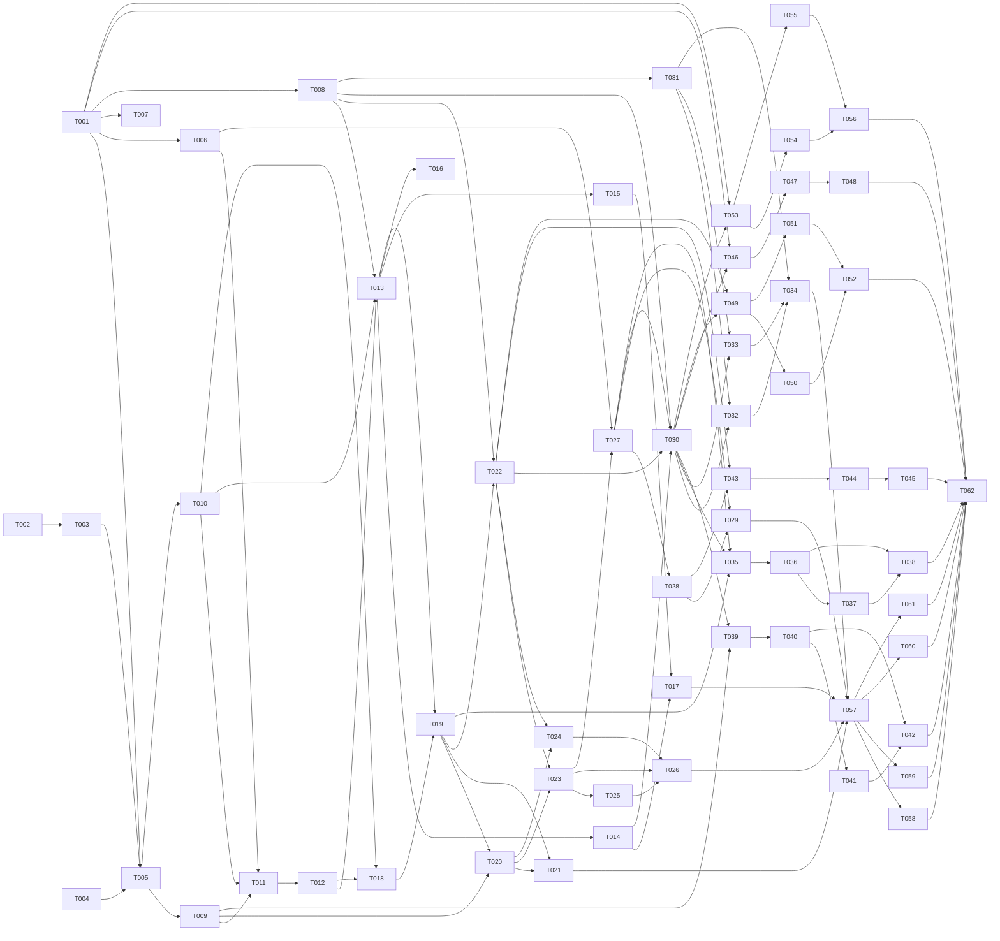

# Tasks: Small-Business Commerce Operations Kernel & Capability Packs (`003`)

> "Never half-ass two things. Whole-ass one thing." («Никогда не делай два дела вполсилы. Делай одно дело на всю катушку.») — Рон Свонсон (_Parks and Recreation_)  
> "Чё там с сосисками, Чарли? — Пять минут, Турецкий. — Пять минут назад ты сказал, что будет готово через две минуты!" — _Большой куш / Snatch_  
> "Первые 90% проекта занимают 90% времени. Оставшиеся 10% — другие 90%." — The 90-90 rule

**Input**: Design documents from `/specs/003-commerce-operations-capability-packs/` (`spec.md`, `plan.md`, `research.md`, `data-model.md`, `contracts/api-contracts.md`, `quickstart.md`)  
**Prerequisites**: `plan.md` (completed), `spec.md` (clarified 5/5: `Q1 Option B`, `Q2 Option B`, `Q3 Option B`, `Q4 Option A`, `Q5 Option B`), `research.md`, `data-model.md`, `contracts/api-contracts.md`  
**Standard Compliance**: ISO/IEC/IEEE 29148:2018, ISO/IEC/IEEE 12207:2017 & NIST SP 800-218 SSDF

---

## Format: `- [ ] [TaskID] [AGENT] [Story?] Description with file path`

- **[AGENT]**: Specialist agent responsible for the task (`[SETUP]`, `[DB]`, `[BE]`, `[FE]`, `[OPS]`, `[E2E]`, `[SEC]`, `[PERF]`, `[DOC]`)
- **[Story]**: User story label (`[US1]`..`[US11]`) — required on all User Story phase tasks (`Phase 3`–`Phase 13`), omitted on Setup (`Phase 1`), Foundational (`Phase 2`), and Polish (`Phase 14`) phases
- **Delivery Tier Mapping (`Q1 Option B`)**:
  - **Tier 1 — Mandatory Production MVP (`Release 003.1`)**: `Phase 1 (Setup)` + `Phase 2 (Foundational)` + `Phase 3 (US1)` + `Phase 4 (US2)` + `Phase 5 (US3)` + `Phase 6 (US4)` + `Phase 7 (US5)` + `Phase 14 (Polish & Single-VPS Gate)`
  - **Tier 2 — Subsequent Capability Pack Phases (`Releases 003.2+`)**: `Phase 8 (US6)` + `Phase 9 (US7)` + `Phase 10 (US8)` + `Phase 11 (US9)` + `Phase 12 (US10)`
  - **Tier 3 — Portfolio Engineering AI Lab Workstream (`Phase H`)**: `Phase 13 (US11)`

---

## Phase 1: Setup (Shared Infrastructure & Supply-Chain Governance)

**Purpose**: Shared configuration schemas, OSS attribution manifest, dependency license verification, and spike disposal check before foundational DB/service work begins.

- [ ] T001 [SETUP] Create Zod client customization manifest, feature-fit validator (`FR-329`), and capability pack toggle schema with typed inputs/outputs in `config/client-manifest.schema.ts`
- [ ] T002 [SETUP] Create permissive OSS attribution registry (`MIT`, `BSD-3-Clause`, `Apache-2.0` allowlist) and automated path-level license gate in `config/oss-reuse-registry.json`
- [ ] T003 [OPS] Run dependency vulnerability scan (`npm audit`) and copyleft license check (`zero AGPLv3/GPLv3/MSCL/ELv2`) in `scripts/verify-licenses.mjs`
- [ ] T004 [SETUP] Spike disposal verification: ensure zero temporary prototype branches or unredacted spike fixtures exist in repository root per `specs/003-commerce-operations-capability-packs/research.md`

---

## Phase 2: Foundational — Tier 1 Production MVP Kernel Prerequisites (`003.1` Phase A)

**Purpose**: Core single-tenant schema expansion (`Q4 Option A`), 3-role session-based staff authentication (`Q2/Q3 Option B`), `CurrencyMetadata`, unified `Party` & `Offering` foundation, `CapabilityModule` registry, and bounded 4-stage backfill (`NFR-305`).

**⚠️ CRITICAL**: No user story phase can begin until this phase is complete (sync barrier).

- [ ] T005 [DB] Stage 1 Expand DDL: add `StaffMember`, `StaffSession`, `Party`, `PartyIdentifier`, `ContactPoint`, `ChannelIdentity`, `PartyNote`, `PartyTag`, `CurrencyMetadata`, `Offering`, `OfferingVariant`, `ServicePolicy`, `BundleComponent`, `InventoryBalance`, `InventoryMovement`, `Resource`, `AvailabilityException`, `OrderLine`, `PaymentPlan`, `PaymentMilestone`, `PaymentAllocation`, `FulfillmentPlan`, `FulfillmentSegment`, `CompletionEvidence`, `OperatorAction`, `AuditEvent`, and nullable `Order.partyId` via Prisma ORM with `lock_timeout = '2s'`, `statement_timeout = '5s'`, and `down.sql` in `prisma/schema.prisma` and `prisma/migrations/20261022000000_003_kernel_expand/migration.sql`
- [ ] T006 [BE] Implement `CurrencyMetadata` minor-unit resolver and formatter with typed inputs/outputs (eliminating hardcoded `/ 100` assumptions, `FR-303`) in `lib/kernel/currency.ts`
- [ ] T007 [BE] Implement compiled `CapabilityModule` registry (`id`, `version`, `requiredCapabilities`, `registerRoutes`, `registerJobs`, `registerPolicies`, `registerReadModels`) with typed inputs/outputs and `INV-011` historical read preservation (`FR-325`) in `lib/kernel/capabilityRegistry.ts`
- [ ] T008 [BE] Implement individual `StaffMember` `scrypt` authentication, `StaffSession` (`sha256` token hash) cookie management, fixed 3-role policy guard (`OWNER > OPERATOR > PERFORMER`, `FR-325a`), per-user session revocation, and audited break-glass `ADMIN_TOKEN` fallback (`BREAK_GLASS_ADMIN_TOKEN_USED`, `FR-325b`) with typed inputs/outputs in `lib/security/staffSession.ts`, `lib/security/staffRbac.ts`, and `lib/security/adminAuth.ts`
- [ ] T009 [BE] Implement unified `Party` resolution and dual-write service (`PERSON | ORGANIZATION`, `PartyIdentifier`, `ContactPoint`, `ChannelIdentity`, `MessengerContact` sync, `FR-304`) with typed inputs/outputs via Prisma ORM in `lib/kernel/partyService.ts`
- [ ] T010 [BE] Implement unified `Offering` and `OfferingVariant` catalog service (`PRODUCT | SERVICE | BUNDLE | DIGITAL | CUSTOM_QUOTE`, `ServicePolicy`, `BundleComponent`, `Item` dual-write, `FR-301`, `FR-302`) with typed inputs/outputs via Prisma ORM in `lib/kernel/offeringService.ts`
- [ ] T011 [DB] Stage 2 Bounded Backfill: implement idempotent batch migration script (`LIMIT 500 FOR UPDATE SKIP LOCKED`) populating `CurrencyMetadata`, `Resource`, bootstrap `OWNER` `StaffMember`, `Offering`/`OfferingVariant`, `Party`, `OrderLine`, `PaymentPlan`, and `FulfillmentPlan` from `001`/`002` data via Prisma ORM in `scripts/backfill-003-kernel.ts` and `prisma/migrations/20261022010000_003_kernel_backfill/migration.sql`
- [ ] T012 [DB] Stage 3 Validate & Cutover DDL: add `CHECK ("partyId" IS NOT NULL) NOT VALID` on `Order`, execute separate `VALIDATE CONSTRAINT`, and provide `down.sql` (`NFR-305`) in `prisma/migrations/20261022020000_003_kernel_validate_cutover/migration.sql`

**Checkpoint**: Foundation ready — Production MVP User Stories (`US1`–`US5`) can now proceed.

---

## Phase 3: User Story 1 — Selling Physical Goods with Auditable Inventory Movements (Priority: P1) 🎯 Production MVP (`003.1`)

**Goal**: Enable selling physical goods (`OfferingKind.PRODUCT`) with SKU variants where stock is modified exclusively via immutable `InventoryMovement` ledger entries (`FR-308`, `INV-003`) and post-payment stock depletion creates an `OperatorAction` without rolling back accepted payments (`INV-002`).

**Independent Test**: Seed a `PRODUCT` variant with `+5` stock via `InventoryMovement(INITIAL)`, reserve `2` units on checkout, commit on fulfillment, and simulate a concurrent payment on `0` stock to verify `PAID_REQUIRES_RESOLUTION` + `OperatorAction(OUT_OF_STOCK_AFTER_PAYMENT)`.

- [ ] T013 [BE] [US1] Implement transactional `InventoryMovement` ledger (`INITIAL`, `RESERVE`, `COMMIT`, `RELEASE`, `ADJUSTMENT`, `RETURN`, `DAMAGE`) and `InventoryBalance` updater (`FR-308`, `INV-003`) with typed inputs/outputs via Prisma ORM in `lib/kernel/inventoryLedger.ts`
- [ ] T014 [BE] [US1] Implement post-payment stock depletion guard (`INV-002`) transitioning depleted paid orders to `PAID_REQUIRES_RESOLUTION` and enqueuing `OperatorAction(OUT_OF_STOCK_AFTER_PAYMENT)` with typed inputs/outputs in `lib/payments/fulfillment.ts`
- [ ] T015 [BE] [US1] Implement admin catalog offering and inventory movement endpoints (`POST /api/admin/catalog/offerings`, `POST /api/admin/inventory/movements`) with Zod validation, `OPERATOR`/`OWNER` role check, and structured error handling in `app/api/admin/catalog/offerings/route.ts` and `app/api/admin/inventory/movements/route.ts`
- [ ] T016 [FE] [US1] Update product card and catalog drawer to display variant SKU availability and support `OfferingKind.PRODUCT` selection in `components/catalog/ItemCard.tsx` and `components/catalog/CartDrawer.tsx`
- [ ] T017 [BE] [US1] Write TDD-Lite unit and concurrency tests for `InventoryMovement` ledger invariance (`available == onHand - reserved`) and `OUT_OF_STOCK_AFTER_PAYMENT` fallback in `tests/unit/inventory-ledger.test.ts`

---

## Phase 4: User Story 2 — Single & Multi-Service Booking with Staff, Resource & Buffer Capacity (Priority: P1) 🎯 Production MVP (`003.1`)

**Goal**: Generalize single and multi-service booking behind the unified `CapacityPort` (`checkCapacity`, `reserveCapacity`, `commitCapacity`, `releaseCapacity`, `FR-307`) enforcing `WorkingSchedule`, `AvailabilityException`, `bufferBeforeMin`/`bufferAfterMin`, `acquireResourceSlotLock`, and PostgreSQL GiST `slot_resource_no_overlap` (`FR-309`, `INV-004`).

**Independent Test**: Configure a 60-min service with 15-min `bufferAfterMin` and a 30-min add-on; verify `checkCapacity` returns only 105-min contiguous windows excluding `AvailabilityException` dates, and concurrent overlapping locks on the same `resourceId` return HTTP 409 (`23P01`).

- [ ] T018 [BE] [US2] Extend contiguous window generator to evaluate `AvailabilityException`, `ServicePolicy.bufferBeforeMin`, and `ServicePolicy.bufferAfterMin` (`FR-309`) with typed inputs/outputs in `lib/booking/windows.ts`
- [ ] T019 [BE] [US2] Implement unified `CapacityPort` (`checkCapacity`, `reserveCapacity`, `commitCapacity`, `releaseCapacity`, `FR-307`) combining `InventoryMovement` and resource-locked `SlotReservation` with typed inputs/outputs via Prisma ORM in `lib/kernel/capacityPort.ts`
- [ ] T020 [BE] [US2] Update `/api/booking/slots` and `/api/booking/lock` route handlers to invoke `CapacityPort` and `Party` blacklist checks with Zod validation and structured error handling in `app/api/booking/slots/route.ts` and `app/api/booking/lock/route.ts`
- [ ] T021 [BE] [US2] Write TDD-Lite unit and integration tests for `CapacityPort` buffer intervals, `AvailabilityException` filtering, and GiST `23P01` collision rejection in `tests/unit/capacity-port.test.ts`

---

## Phase 5: User Story 3 — Mixed Goods-and-Services Order & Segmented Fulfillment Plan (Priority: P1) 🎯 Production MVP (`003.1`)

**Goal**: Support mixed baskets (physical goods + scheduled services/bundles) in one `Order` with immutable `OrderLine` snapshots (`FR-312`, `INV-001`), segmented `FulfillmentPlan` (`INVENTORY`, `APPOINTMENT`, `DIGITAL`, `DELIVERY`, `MANUAL_MILESTONE`, `FR-318`), and `PERFORMER`-submitted `CompletionEvidence` (`FR-319`).

**Independent Test**: Submit a mixed order (1 `PRODUCT` + 1 `SERVICE`), verify atomic stock reservation + slot hold, verify two independent `FulfillmentSegment` rows are created, and submit `CompletionEvidence` as an authenticated `PERFORMER` to transition the order to `FULFILLED`.

- [ ] T022 [BE] [US3] Implement `FulfillmentPlan`, `FulfillmentSegment`, neutral `FulfillmentProvider`, and `CompletionEvidence` application service (`FR-318`, `FR-319`) with typed inputs/outputs and `PERFORMER` assignment checks via Prisma ORM in `lib/kernel/fulfillmentPlanService.ts`
- [ ] T023 [BE] [US3] Update `POST /api/checkout` to create immutable `OrderLine` snapshots (`FR-312`, `INV-001`), reserve mixed capacity via `CapacityPort`, and initialize `FulfillmentPlan` segments with Zod validation and structured error handling in `app/api/checkout/route.ts`
- [ ] T024 [BE] [US3] Implement `GET /api/admin/fulfillment/my-segments` and `POST /api/admin/fulfillment/segments/[id]/evidence` endpoints (`PERFORMER` / `OPERATOR` / `OWNER` RBAC + `actorId` audit) with Zod validation and structured error handling in `app/api/admin/fulfillment/my-segments/route.ts` and `app/api/admin/fulfillment/segments/[id]/evidence/route.ts`
- [ ] T025 [FE] [US3] Update checkout modal and booking flow to support mixed product-and-service carts and display segmented fulfillment summary in `components/checkout/CheckoutModal.tsx` and `app/checkout/page.tsx`
- [ ] T026 [BE] [US3] Write TDD-Lite tests for mixed goods-and-services order creation, independent `FulfillmentSegment` progression, and `PERFORMER` `CompletionEvidence` authorization in `tests/unit/fulfillment-plan.test.ts`

---

## Phase 6: User Story 4 — Deposit, Milestone & Balance Payment Plans with Explicit Allocations (Priority: P1) 🎯 Production MVP (`003.1`)

**Goal**: Replace binary payment flags with `PaymentPlan`, `PaymentMilestone` (`DEPOSIT`, `MILESTONE`, `BALANCE`, `ON_SITE`), capability-declared `PaymentProvider` adapters, and explicit `PaymentAllocation` records linking `PaymentEvent` and `RefundOperation` rows (`FR-315`, `FR-316`).

**Independent Test**: Create an order with a `30% DEPOSIT` / `70% BALANCE` plan, capture the 30% deposit, verify `PaymentAllocation` marks Milestone 1 `PAID` and order `PARTIALLY_PAID`, and verify `CashCommitmentView` reports exact paid and due amounts.

- [ ] T027 [BE] [US4] Implement capability-declared `PaymentProvider` registry (`PaymentProviderCapabilities`, `FR-316`) and `PaymentPlan` / `PaymentMilestone` / `PaymentAllocation` service (`FR-315`) with typed inputs/outputs via Prisma ORM in `lib/kernel/paymentPlanService.ts`
- [ ] T028 [BE] [US4] Wire Telegram Stars (`lib/payments/stars.ts`), NOWPayments (`lib/payments/nowpayments.ts`), and `RefundOperation` (`lib/payments/refunds.ts`) to record explicit `PaymentAllocation` entries without mutating `PaymentEvent` (`INV-007`)
- [ ] T029 [BE] [US4] Write TDD-Lite unit tests for 30/70 deposit-balance `PaymentPlan` lifecycle, partial refund allocations, and `CashCommitmentView` aggregation in `tests/unit/payment-plan.test.ts`

---

## Phase 7: User Story 5 — Exception-Driven Operator Work Queue, Session Auth & Role-Bounded Resolution (Priority: P1) 🎯 Production MVP (`003.1`)

**Goal**: Provide the exception-driven `OperatorAction` work queue (`FR-321`), core PII-redacted read models (`FR-305`, `FR-326`), individual staff login/logout/provisioning/revocation endpoints (`FR-325b`), and role-gated Telegram Staff Bot callbacks (`FR-325a`).

**Independent Test**: Login as `OWNER`, create `OPERATOR` and `PERFORMER` accounts, trigger an operational exception, resolve it as `OPERATOR` via `/api/admin/operator-actions/[id]/resolve`, verify `AuditEvent` records `actorId` + `actorRole`, verify `PERFORMER` is blocked from refund/config routes (`403`), and verify session revocation immediately returns `401`.

- [ ] T030 [BE] [US5] Implement `OperatorAction` lifecycle service (`enqueueOperatorAction`, `resolveOperatorAction`, `FR-321`) and PII-redacted read models (`OperatorActionView`, `OrderSummaryView`, `PartyTimelineView`, `AvailabilityView`, `CatalogSearchView`, `PaymentStatusView`, `CashCommitmentView`, `FR-305`, `FR-326`) with typed inputs/outputs via Prisma ORM in `lib/kernel/operatorActionService.ts` and `lib/kernel/readModels.ts`
- [ ] T031 [BE] [US5] Implement staff auth and management endpoints (`POST /api/admin/auth/login`, `POST /api/admin/auth/logout`, `POST /api/admin/staff`, `POST /api/admin/staff/[id]/revoke-sessions`, `FR-325b`) with Zod validation and structured error handling in `app/api/admin/auth/login/route.ts`, `app/api/admin/auth/logout/route.ts`, `app/api/admin/staff/route.ts`, and `app/api/admin/staff/[id]/revoke-sessions/route.ts`
- [ ] T032 [BE] [US5] Implement `GET /api/admin/operator-actions` and `POST /api/admin/operator-actions/[id]/resolve` endpoints with Zod validation, `OPERATOR`/`OWNER` RBAC, and structured error handling in `app/api/admin/operator-actions/route.ts` and `app/api/admin/operator-actions/[id]/resolve/route.ts`
- [ ] T033 [BE] [US5] Update Telegram Staff Bot callback authorization (`lib/bot/staffActions.ts`) to resolve `StaffMember` by `telegramUserId`, enforce `OWNER | OPERATOR | PERFORMER` permissions (`FR-325a`), reject deactivated/revoked staff, and record `actorId` + `actorRole` in `AuditEvent`
- [ ] T034 [SEC] [US5] Write TDD-Lite security and RBAC tests covering `StaffSession` login/revocation (`401`), `PERFORMER`/`OPERATOR`/`OWNER` permission boundaries (`403`), break-glass `ADMIN_TOKEN` audit logging, and `OperatorAction` resolution in `tests/unit/staff-rbac-and-sessions.test.ts`

**Checkpoint — Tier 1 Production MVP (`003.1`) Complete**: All mandatory Production MVP requirements (`Q1–Q5`) are implemented and independently testable.

---

## Phase 8: User Story 6 — Capacity-Aware Custom Quotes, Margin Guard & Quote-to-Order Conversion (Priority: P2 — Subsequent Phase Pack `Phase C`)

**Goal**: Deliver the optional `Quote Pack` (`Quote`, `QuoteLine`, modes `INFORMATIONAL | PRICE_LOCKED | CAPACITY_HELD | DEPOSIT_BACKED`), `MarginGuard` approval gate, and transactional quote-to-order conversion (`FR-310`, `FR-311`, `FR-313`, `INV-005`).

**Independent Test**: Create `Quote` v1, revise to v2 below margin threshold, verify `MarginGuard` requires `OWNER` approval, accept v2 as customer, and verify `Order` is created from v2 snapshots after capacity re-validation.

- [ ] T035 [DB] [US6] Add `Quote` and `QuoteLine` models to `prisma/schema.prisma` and generate additive migration with `down.sql` in `prisma/migrations/20261023000000_003_quote_pack/migration.sql`
- [ ] T036 [BE] [US6] Implement `Quote` versioning (`FR-310`), `MarginGuard` policy evaluator (`FR-313`), and transactional quote-to-order conversion service (`FR-311`, `INV-005`) with typed inputs/outputs via Prisma ORM in `lib/packs/quotes/quoteService.ts`
- [ ] T037 [BE] [US6] Implement quote API endpoints (`POST /api/admin/quotes`, `POST /api/admin/quotes/[id]/approve-margin`, `POST /api/quotes/[id]/accept`) with Zod validation and structured error handling in `app/api/admin/quotes/route.ts` and `app/api/quotes/[id]/accept/route.ts`
- [ ] T038 [BE] [US6] Write unit tests for `Quote` versioning, `MarginGuard` blocking, and stale-capacity rejection on quote acceptance in `tests/unit/quote-pack.test.ts`

---

## Phase 9: User Story 7 — Unified Party Timeline, Conversation-to-Draft & Resumable Guest Journeys (Priority: P2 — Subsequent Phase Pack `Phase E`)

**Goal**: Deliver operator-approved conversation-to-draft conversion (`FR-322`), HMAC-signed cross-channel `ContinuationLink` guest journeys (`Journey`, `JourneyToken`, `FR-323`), operator-facing `ActionSuggestion` records (`FR-306`), and limited-connectivity non-financial draft reconciliation (`FR-324`).

**Independent Test**: Convert a customer Telegram message into an operator-approved `Booking Draft`, issue a `ContinuationLink`, resume the draft in a web session, reconcile a queued offline `CompletionEvidence` draft, and verify all events appear in `PartyTimelineView`.

- [ ] T039 [DB] [US7] Add `Journey`, `JourneyToken`, and `ActionSuggestion` models to `prisma/schema.prisma` and generate additive migration with `down.sql` in `prisma/migrations/20261023010000_003_journey_pack/migration.sql`
- [ ] T040 [BE] [US7] Implement operator-approved conversation-to-draft service (`FR-322`), HMAC-SHA256 `ContinuationLink` token issuer/verifier (`FR-323`), evidence-backed `ActionSuggestion` generator (`FR-306`), and limited-connectivity non-financial draft reconciliation service (`FR-324`) with typed inputs/outputs in `lib/packs/operations/journeyService.ts`
- [ ] T041 [BE] [US7] Implement `POST /api/admin/conversations/to-draft`, `GET /api/journey/[token]`, and `POST /api/admin/drafts/reconcile` endpoints with Zod validation and structured error handling in `app/api/admin/conversations/to-draft/route.ts`, `app/api/journey/[token]/route.ts`, and `app/api/admin/drafts/reconcile/route.ts`
- [ ] T042 [BE] [US7] Write unit tests for `ContinuationLink` single-use/TTL verification, `ActionSuggestion` approval gating (`FR-306`), and offline non-financial draft reconciliation (`FR-324`) in `tests/unit/journey-continuation.test.ts`

---

## Phase 10: User Story 8 — Immutable Order Change Requests, Cancellations & Reversals (Priority: P2 — Subsequent Phase Pack `Phase D/E`)

**Goal**: Deliver auditable `ChangeRequest` order amendments (`FR-314`), selective capacity release (`US7`), and neutral `CommercialDocument` / `CREDIT_NOTE` reversals (`FR-317`, `INV-006`, `INV-007`).

**Independent Test**: Amend an accepted mixed order to cancel only the product line; verify only product inventory is released while the service slot remains `BOOKED`, and a compensating `CREDIT_NOTE` / `RefundOperation` is linked.

- [ ] T043 [DB] [US8] Add `ChangeRequest`, `CommercialDocument`, `CommercialDocumentLine`, `DocumentRender`, `ExternalDocumentReference`, and `NumberingProfile` models to `prisma/schema.prisma` and generate additive migration in `prisma/migrations/20261023020000_003_documents_change_pack/migration.sql`
- [ ] T044 [BE] [US8] Implement `ChangeRequest` delta calculator (`FR-314`, selective `releaseCapacity`) and `CommercialDocument` / `CREDIT_NOTE` reversal service (`FR-317`, `INV-006`, `INV-007`) with typed inputs/outputs via Prisma ORM in `lib/packs/documents/changeRequestService.ts`
- [ ] T045 [BE] [US8] Write unit tests for partial mixed-order cancellation (`US7`) and immutable invoice `CREDIT_NOTE` reversal (`US8`) in `tests/unit/change-request-and-documents.test.ts`

---

## Phase 11: User Story 9 — Jurisdiction-Neutral Compliance Adapters & Client Customization Manifest (Priority: P2 — Subsequent Phase Pack `Phase F`)

**Goal**: Deliver `JurisdictionProfile`, the 5 narrow compliance SPI ports (`TaxQuoteProvider`, `FiscalReceiptProvider`, `ElectronicInvoiceProvider`, `ProductComplianceProvider`, `TransportDocumentProvider`), the feature-fit manifest wizard (`FR-329`), and the `NOT_COMPLIANCE_READY` sign-off gate (`FR-328`–`FR-330`, `INV-J01`–`INV-J08`).

**Independent Test**: Switch manifests between `USD` (`minorUnit = 2`) and `JPY` (`minorUnit = 0`) with a mocked `FiscalReceiptProvider`, verify `NOT_COMPLIANCE_READY` gating until `OWNER` sign-off, and simulate a post-payment fiscal timeout to verify `Order` remains `PAID` while `OperatorAction(COMPLIANCE_PROVIDER_FAILURE)` is created.

- [ ] T046 [DB] [US9] Add `JurisdictionProfile`, `ComplianceOperationRequest`, and `ComplianceOperationResult` models to `prisma/schema.prisma` and generate additive migration in `prisma/migrations/20261023030000_003_compliance_pack/migration.sql`
- [ ] T047 [BE] [US9] Implement the 5 narrow compliance provider SPIs (`FR-328`), `JurisdictionProfile` loader, feature-fit manifest evaluator (`FR-329`), `NOT_COMPLIANCE_READY` sign-off gate (`FR-330`, `POST /api/admin/compliance/sign-off`), and post-payment fail-safe `OperatorAction` fallback (`INV-J05`) with typed inputs/outputs in `lib/packs/compliance/complianceRegistry.ts` and `app/api/admin/compliance/sign-off/route.ts`
- [ ] T048 [BE] [US9] Write unit and AST verification tests confirming zero hardcoded country codes in `lib/kernel/` (`INV-J01`), `NOT_COMPLIANCE_READY` sign-off enforcement (`FR-330`), and post-payment compliance failure isolation (`INV-J05`) in `tests/unit/jurisdiction-neutrality.test.ts`

---

## Phase 12: User Story 10 — Redacted Read Models, Order-Linked Post-Sale Cases & Safe Staged Imports (Priority: P3 — Subsequent Phase Pack `Phase E/G`)

**Goal**: Deliver order-linked `ServiceCase` / `WarrantyCoverage` (`FR-320`), `DataQualityIssue` scanner + quarantined `ImportBatch` pipeline (`FR-327`), and the optional read-only `Agent Read Pack` projection surface (`FR-326`, `INV-008`, `INV-010`).

**Independent Test**: Stage a CSV with duplicate phones in `ImportBatch` and verify quarantine blocks live table writes until `OWNER` approval; query `Agent Read Pack` projections and verify zero PII and zero mutation tools.

- [ ] T049 [DB] [US10] Add `ServiceCase`, `WarrantyCoverage`, `DataQualityIssue`, `ImportBatch`, `ImportRow`, and `ImportIssue` models to `prisma/schema.prisma` and generate additive migration in `prisma/migrations/20261023040000_003_ops_import_pack/migration.sql`
- [ ] T050 [BE] [US10] Implement `ServiceCase` post-sale service (`FR-320`), `DataQualityIssue` diagnostic scanner, and quarantined `ImportBatch` staging service (`FR-327`) with typed inputs/outputs via Prisma ORM in `lib/packs/operations/importAndQualityService.ts`
- [ ] T051 [BE] [US10] Implement read-only `Agent Read Pack` projection adapter (`CatalogSearchView`, `AvailabilityView`, `OrderSummaryView`, `OperatorActionView`, `FR-326`) with zero mutation tools (`INV-008`, `INV-010`) in `lib/packs/agentRead/mcpReadAdapter.ts`
- [ ] T052 [SEC] [US10] Write automated privacy and staging tests verifying `ImportBatch` quarantine isolation and `0` bytes of raw PII or write tools on `Agent Read Pack` in `tests/unit/agent-read-and-import.test.ts`

---

## Phase 13: User Story 11 — Portfolio Engineering Lab: Local LLM (`LM Studio`) + `OmniRoute` AI Gateway & Outage Drill (Priority: P3 — Portfolio Workstream `Phase H`)

**Goal**: Deliver the provider-agnostic `LanguageModelGateway` port (`FR-331`), `LM Studio` + `OmniRoute` sidecar lab compose profile (`FR-332`), `AiDataClass` routing with local fail-closed confidentiality (`FR-333`), dual redacted AI telemetry, golden-dataset benchmark, and recorded local-model outage drill (`FR-334`, `P-AI-001`–`P-AI-008`).

**Independent Test**: Run `scripts/ai-benchmark.ts` and `scripts/ai-outage-drill.ts`; verify `AiDataClass.CONFIDENTIAL` fails closed (`0` cloud fallbacks) when `LM Studio` is stopped while `commerce-core` remains `100%` unaffected.

- [ ] T053 [BE] [US11] Implement `LanguageModelGateway` (`generate`, `stream`, `health`, `FR-331`), `AiDataClass` routing policy (`CONFIDENTIAL` local-only fail-closed, `deniedProviderClasses: ['web-cookie', 'unofficial-proxy']`, `FR-333`), and PII-free `AiTelemetryRecord` logger (`FR-334`) with typed inputs/outputs in `lib/ai/gateway.ts`, `lib/ai/routingPolicy.ts`, and `lib/ai/telemetry.ts`
- [ ] T054 [OPS] [US11] Create optional Engineering Lab Docker Compose topology (`OmniRoute` sidecar + local `LM Studio` endpoint over private WireGuard/Tailscale subnet, isolated from the 500 MB commerce-core container, `FR-332`) in `infrastructure/compose/ai-lab.compose.yml`
- [ ] T055 [BE] [US11] Implement reproducible golden-dataset benchmark runner (`NFR-307`) and local `LM Studio` outage drill script (`FR-334`, `P-AI-005`–`P-AI-007`) in `scripts/ai-benchmark.ts` and `scripts/ai-outage-drill.ts`
- [ ] T056 [BE] [US11] Write unit and contract tests for `LanguageModelGateway` timeouts (`4s`/`3s`/`8s`, `NFR-306`), `CONFIDENTIAL` fail-closed routing, and redacted telemetry in `tests/unit/ai-gateway-lab.test.ts`

---

## Phase 14: Polish, Stage 4 Contract & Single-VPS Operational Readiness Gate

**Purpose**: Finalize Stage 4 Contract migration, verify Single-VPS concurrency/memory/DR baseline (`Q5 Option B`: `99.0% uptime`, `RTO <= 60m`, `RPO <= 24h`, `100 concurrent reqs`, `app RSS <= 500 MB`), audit PII redaction, and update living documentation.

- [ ] T057 [DB] Stage 4 Contract migration: promote validated constraints, retire temporary dual-write shims while preserving historical order readability (`INV-011`), and verify `down.sql` rollback in `prisma/migrations/20261022030000_003_kernel_contract/migration.sql`
- [ ] T058 [PERF] Execute Single-VPS 100-concurrency load and memory benchmark (`checkCapacity` p95 < 50ms, write commands p95 < 250ms, main container `app RSS <= 500 MB`, `NFR-301`–`NFR-303`) in `tests/unit/performance-benchmark.test.ts` and `docker/bench-memory.sh`
- [ ] T059 [OPS] Implement and execute Single-VPS automated `pg_dump` backup & restore drill verifying `RTO <= 60 minutes` and `RPO <= 24 hours` (`NFR-304`, `SC-002`) in `scripts/verify-single-vps-dr.sh`
- [ ] T060 [SEC] Audit structured telemetry logs, read models, and error payloads for zero raw PII or credential leakage (`INV-010`) and verify single-tenant DB schema isolation (`FR-325c`, `INV-013`) in `tests/unit/security-and-pii-audit.test.ts`
- [ ] T061 [DOC] Update living documentation (`specs/main/README.md`, `specs/main/architecture.md`, `specs/main/requirements.md`, and `docs/whitelabel-quickstart.md`) with Feature 003 runbooks and Single-VPS DR procedures
- [ ] T062 [OPS] Run full constitutional quality gate (`npm run validate`, `npm test`, `npm run build`, `scripts/verify-licenses.mjs`, `quickstart.md` tracer bullet verification)

---

## Dependency Graph

### Legend
- `→` means "unlocks" (left must complete before right can start)
- `+` means "all of these" (join point — ALL listed tasks must complete)

### Dependencies

```text
T001 → T005, T006, T007, T008
T002 → T003
T003 + T004 → T005
T005 → T009, T010
T006 + T009 + T010 → T011
T011 → T012
T008 + T010 + T012 → T013
T013 → T014, T015, T016
T014 + T015 → T017
T010 + T012 → T018
T013 + T018 → T019
T009 + T019 → T020
T019 + T020 → T021
T008 + T019 → T022
T020 + T022 → T023, T024
T023 → T025
T023 + T024 + T025 → T026
T006 + T023 → T027
T027 → T028
T027 + T028 → T029
T008 + T014 + T022 + T027 → T030
T008 → T031
T030 + T031 → T032, T033
T031 + T032 + T033 → T034
T019 + T027 + T030 → T035
T035 → T036
T036 → T037
T036 + T037 → T038
T009 + T030 → T039
T039 → T040
T040 → T041
T040 + T041 → T042
T022 + T028 → T043
T043 → T044
T044 → T045
T001 + T030 → T046
T046 → T047
T047 → T048
T022 + T030 → T049
T049 → T050, T051
T050 + T051 → T052
T001 + T030 → T053
T053 → T054, T055
T054 + T055 → T056
T017 + T021 + T026 + T029 + T034 → T057
T057 → T058, T059, T060, T061
T038 + T042 + T045 + T048 + T052 + T056 + T058 + T059 + T060 + T061 → T062
```

### Self-Validation Checklist
- [x] Every task ID in Dependencies (`T001`–`T062`) exists in the task list above
- [x] No circular dependencies (`A → B → A`)
- [x] No orphan task IDs referenced that don't exist
- [x] Fan-in uses `+` only, fan-out uses `,` only
- [x] No chained arrows on a single line

---

## Dependency Visualization



---

## Parallel Lanes

| Lane | Agent Flow | Tasks | Blocked By |
| :--- | :--- | :--- | :--- |
| **Lane 1: Setup & Governance** | `[SETUP]`, `[OPS]` | `T001`, `T002` → `T003`, `T004` | — |
| **Lane 2: Database & 4-Stage DDL** | `[DB]` | `T005` → `T011` → `T012` → `T035`, `T039`, `T043`, `T046`, `T049`, `T057` | `T001`, `T003`, `T004` |
| **Lane 3: MVP Kernel Services & APIs (`003.1`)** | `[BE]` | `T006`, `T007`, `T008`, `T009`, `T010` → `T013`..`T015`, `T018`..`T024`, `T027`..`T033` | `T005`, `T012` |
| **Lane 4: Storefront & Checkout UI (`003.1`)** | `[FE]` | `T016`, `T025` | `T013`, `T023` |
| **Lane 5: Phase 2 Capability Packs (`003.2+`)** | `[BE]` | `T036`..`T038`, `T040`..`T042`, `T044`..`T045`, `T047`..`T048`, `T050`..`T051` | `T030`, `T035`..`T049` |
| **Lane 6: Portfolio Engineering AI Lab (`Phase H`)** | `[BE]`, `[OPS]` | `T053` → `T054`, `T055` → `T056` | `T001`, `T030` |
| **Lane 7: Security, Perf & Single-VPS DR Gate** | `[SEC]`, `[PERF]`, `[OPS]`, `[DOC]` | `T034`, `T052`, `T058`, `T059`, `T060`, `T061` → `T062` | `T057` |

---

## Agent Summary

| Agent | Task Count | Can Start After |
| :--- | :--- | :--- |
| `[SETUP]` | 3 | Immediately (`T001`, `T002`, `T004`) |
| `[DB]` | 9 | `T001 + T003 + T004` (`T005`) |
| `[BE]` | 39 | `T001` (`T006`, `T007`, `T008`) |
| `[FE]` | 2 | `T013` (`T016`), `T023` (`T025`) |
| `[OPS]` | 4 | `T002` (`T003`) |
| `[SEC]` | 3 | `T033` (`T034`), `T051` (`T052`), `T057` (`T060`) |
| `[PERF]` | 1 | `T057` (`T058`) |
| `[DOC]` | 1 | `T057` (`T061`) |
| **Total** | **62** | — |

**Critical Path (Production MVP `003.1`)**: `T001 → T005 → T010 → T011 → T012 → T013 → T019 → T020 → T023 → T027 → T030 → T032 → T034 → T057 → T058 → T062`

---

## Agent Dispatch Plan

| Agent | Subagent / Command (`.claude/commands/`) | Skills (`.claude/skills/`) | Input Context | Tasks | Target Files / Directories |
| :--- | :--- | :--- | :--- | :--- | :--- |
| `[SETUP]` | `orchestrator` (`.claude/commands/orchestrator.md`) | `architecture`, `system-design-patterns`, `app-builder`, `clean-code` | `plan.md §2, §4`, `research.md §1, §2` | `T001`, `T002`, `T004` | `config/client-manifest.schema.ts`, `config/oss-reuse-registry.json` |
| `[DB]` | `database-architect` (`.claude/commands/database-architect.md`) | `database-design`, `prisma-expert`, `clean-code` | `data-model.md §1–§4`, `plan.md §6` | `T005`, `T011`, `T012`, `T035`, `T039`, `T043`, `T046`, `T049`, `T057` | `prisma/schema.prisma`, `prisma/migrations/**`, `scripts/backfill-003-kernel.ts` |
| `[BE]` | `backend-specialist` (`.claude/commands/backend-specialist.md`) | `api-patterns`, `nodejs-best-practices`, `typescript-expert`, `clean-code`, `mcp-builder` | `contracts/api-contracts.md §1–§5`, `data-model.md §2–§3`, `plan.md §4` | `T006`–`T010`, `T013`–`T015`, `T017`–`T024`, `T026`–`T033`, `T036`–`T038`, `T040`–`T042`, `T044`–`T045`, `T047`–`T048`, `T050`–`T051`, `T053`, `T055`–`T056` | `lib/security/**`, `lib/kernel/**`, `lib/packs/**`, `lib/ai/**`, `app/api/**`, `tests/unit/**` |
| `[FE]` | `frontend-specialist` (`.claude/commands/frontend-specialist.md`) | `react-patterns`, `nextjs-best-practices`, `tailwind-patterns`, `frontend-design` | `contracts/api-contracts.md §2–§3`, `plan.md §4` | `T016`, `T025` | `components/catalog/**`, `components/checkout/**`, `app/checkout/page.tsx` |
| `[OPS]` | `devops-engineer` (`.claude/commands/devops-engineer.md`) | `docker-expert`, `server-management`, `deployment-procedures`, `bash-linux` | `plan.md §7`, `quickstart.md §2–§3` | `T003`, `T054`, `T059`, `T062` | `scripts/verify-licenses.mjs`, `scripts/verify-single-vps-dr.sh`, `infrastructure/compose/ai-lab.compose.yml` |
| `[SEC]` | `security-auditor` (`.claude/commands/security-auditor.md`) | `vulnerability-scanner`, `ai-engineering-hygiene`, `code-review-checklist` | `spec.md §3.5`, `plan.md §5`, `contracts/api-contracts.md §1, §4` | `T034`, `T052`, `T060` | `tests/unit/staff-rbac-and-sessions.test.ts`, `tests/unit/agent-read-and-import.test.ts`, `tests/unit/security-and-pii-audit.test.ts` |
| `[PERF]` | `performance-optimizer` (`.claude/commands/performance-optimizer.md`) | `performance-profiling`, `system-design-patterns` | `spec.md §3.3 (NFR-301..304)`, `quickstart.md §2` | `T058` | `tests/unit/performance-benchmark.test.ts`, `docker/bench-memory.sh` |
| `[DOC]` | `documentation-writer` (`.claude/commands/documentation-writer.md`) | `documentation-templates`, `knowledge-adaptation` | `plan.md §4, §7`, `quickstart.md` | `T061` | `specs/main/**`, `docs/whitelabel-quickstart.md` |

---

## Implementation Strategy

### 1. Tier 1 Production MVP First (`Release 003.1` — `US1` through `US5`)
1. Complete **Phase 1 (Setup)** and **Phase 2 (Foundational)** (`T001`–`T012`): establishes the 4-stage Expand/Backfill/Cutover schema, `StaffMember` + `StaffSession` auth, 3-role RBAC (`OWNER`, `OPERATOR`, `PERFORMER`), `Party`, and `Offering`.
2. Execute **Phases 3–7 (`US1`–`US5`, `T013`–`T034`)**: delivers `InventoryMovement` ledger, `CapacityPort`, mixed `Order`/`OrderLine` snapshots, `PaymentPlan`/`PaymentAllocation`, `FulfillmentPlan`/`FulfillmentSegment` + `CompletionEvidence`, and `OperatorAction` work queue.
3. Run **Phase 14 (`T057`–`T062`)** against the `003.1` MVP slice to validate the Single-VPS operational baseline (`99.0% uptime`, `RTO <= 60m`, `RPO <= 24h`, `100 concurrent reqs`, `app RSS <= 500 MB`) and ship Release `003.1` within the Sprint B window.

### 2. Incremental Capability Packs (`Releases 003.2+` — `US6` through `US10`) & Portfolio AI Lab (`US11`)
- Enable and ship **Phases 8–12 (`US6`–`US10`, `T035`–`T052`)** as independent modular capability packs (`Quote Pack`, `Journey Pack`, `Documents & ChangeRequest Pack`, `Compliance Pack`, `Import & Agent Read Pack`).
- Execute **Phase 13 (`US11`, `T053`–`T056`)** as an independent portfolio engineering workstream (`LM Studio` + `OmniRoute` AI Gateway + golden benchmark + outage drill) outside the 500 MB production app container.