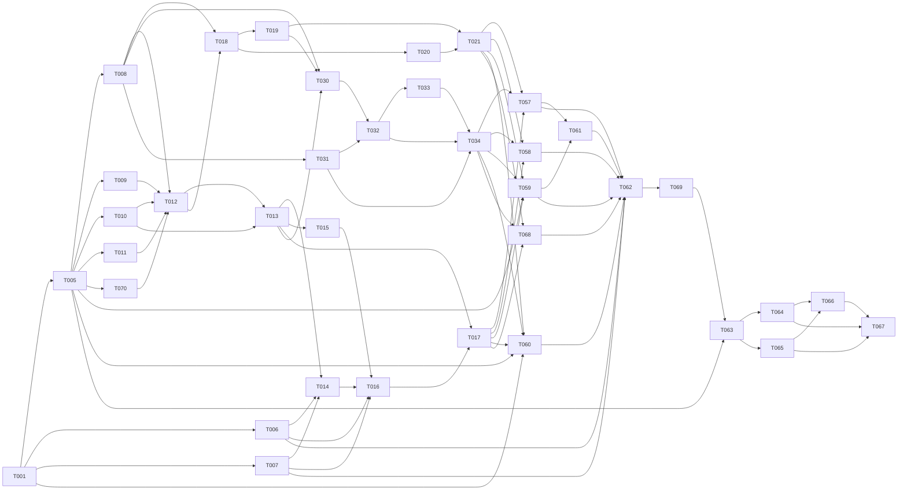

# Tasks: Booking-First Service Template (`003.1`)

> "Never half-ass two things. Whole-ass one thing." («Никогда не делай два дела вполсилы. Делай одно дело на всю катушку.») — Рон Свонсон (_Parks and Recreation_)  
> "Чё там с сосисками, Чарли? — Пять минут, Турецкий. — Пять минут назад ты сказал, что будет готово через две минуты!" — _Большой куш / Snatch_  
> "Первые 90% проекта занимают 90% времени. Оставшиеся 10% — другие 90%." — The 90-90 rule

**Input**: Updated booking-first `spec.md`, `plan.md`, `research.md`, `data_model.md`, `contracts.md`, and `quickstart.md`
**Prerequisites**: Cross-artifact analysis and external reviews must be rerun for this scope before implementation.
**Standard Compliance**: ISO/IEC/IEEE 29148:2018, ISO/IEC/IEEE 12207:2017 & NIST SP 800-218 SSDF

## Business Gate

Do not publish the Sprint B offer or start first-release implementation tasks `T001`–`T062`, `T068`, and `T070` until the business plan's demand gate is met: 10 paid Tripwire audits (`$350`–`$490` each) within the first 60 days. Record the completion date and evidence in the canonical commercial tracker before unblocking the sprint. This plan does not claim that the gate has already been met.

---

## Format: `- [ ] [TaskID] [AGENT] [Story?] Description with file path`

- **[AGENT]**: Specialist agent responsible for the task (`[SETUP]`, `[DB]`, `[BE]`, `[FE]`, `[OPS]`, `[E2E]`, `[SEC]`, `[PERF]`, `[DOC]`)
- **[Story]**: User story label (`[US1]`..`[US12]`) — required on all User Story phase tasks; omitted on Setup, Foundational, and Polish phases
- **Delivery Tier Mapping (Updated 2026-10-22)**:
  - **Tier 1 — Production MVP (`003.1`)**: `Phase 1`, `Phase 2`, `Phase 3 (US12: public professional pages)`, `Phase 4 (US2: appointment booking)`, `Phase 7 (US5: staff access)`, and `Phase 14 (production readiness)`.
  - **Tier 2 — Commerce and Operations Packs (`003.2+`)**: product sales, mixed carts, payment plans, and `Phases 8–12`.
  - **Tier 3 — Optional AI Lab**: `Phase 13 (US11)`.

---

## Phase 1: Setup (Shared Infrastructure & Supply-Chain Governance)

**Purpose**: Business page settings, locale/timezone/currency configuration, OSS attribution, and dependency license verification.

- [ ] T001 [SETUP] Define validated business page settings for name, description, branding, contact links, locale, timezone, and currency (`FR-335`); initialize a new setup to editable `USD` and require owner confirmation or change before live prices are published in `config/shop.config.ts`
- [ ] T002 [SETUP] Create permissive OSS attribution registry (`MIT`, `BSD-3-Clause`, `Apache-2.0` allowlist) and automated path-level license gate in `config/oss-reuse-registry.json`
- [ ] T003 [OPS] Run dependency vulnerability scan (`npm audit`) and copyleft license check (`zero AGPLv3/GPLv3/MSCL/ELv2`) against the lockfile in `scripts/verify-licenses.mjs`
- [ ] T004 [SETUP] Confirm no required integration credentials or country-specific values are committed to the template; document client-supplied configuration inputs.

---

## Phase 2: Foundation — Staff Access, Services & Booking Schema (`003.1`)

**Purpose**: Add only the staff access, professional, service-location, service-price, schedule, and booking data missing from the current application. Preserve existing customer and appointment history.

**⚠️ CRITICAL**: No user story phase can begin until this phase is complete (sync barrier).

- [ ] T005 [DB] Add only missing `StaffMember` (linked to a Better Auth identity), `ProfessionalProfile`, `ProfessionalService`, `PortfolioItem`, `Resource`, schedule fields, and nullable booking-cancellation credential fields using an additive migration; preserve existing customer and appointment tables and generate Better Auth's schema from its selected version in `prisma/schema.prisma` and `prisma/migrations/20261022000000_003_booking_template/migration.sql`
- [ ] T006 [BE] Resolve in-call service prices, outcall service-price overrides, and fixed travel fees from the installation's configured currency; use generic ISO 4217 metadata or explicit non-ISO metadata, and never rely on the legacy `OrderItem.currency` default for a new amount (`FR-303`, `FR-335`, `FR-339`)
- [ ] T007 [BE] Implement owner-managed business location/currency settings, validation/loading for public business settings and service defaults, and a typed build-time capability-pack configuration contract without a runtime plugin registry (`FR-325`, `FR-335`)
- [ ] T008 [BE] Pin a supported Better Auth release exactly in the package manifest and lockfile, then integrate it for staff identity, password verification, PostgreSQL-backed sessions, secure cookies, expiry and revocation; map each authenticated identity to one active `StaffMember`, apply the fixed 3-role policy guard (`OWNER > OPERATOR > PERFORMER`, `FR-325a`), and retain audited break-glass `ADMIN_TOKEN` recovery (`FR-325b`) in `lib/security/auth.ts`, `lib/security/staffRbac.ts`, and `lib/security/adminAuth.ts`
- [ ] T009 [BE] Reuse existing booking customer fields and add only missing contact validation and retention behavior; do not introduce cross-channel Party resolution in the booking release (`FR-304`)
- [ ] T010 [BE] Implement service listings and authorized updates for enabled location modes, per-mode price resolution, fixed outcall travel fees/buffers, professional-to-service associations, profile ownership, publication state, and portfolio item management (`FR-301`, `FR-336`, `FR-338`, `FR-339`)
- [ ] T011 [DB] Implement the migration's dual-write/backfill only for existing values that move to a new representation; use an idempotent, rate-limited backfill and reconcile counts/values, or record verified zero applicable rows for new independent tables (`NFR-305`)
- [ ] T070 [DB] Add `IN_CALL`/`OUT_CALL` mode, service outcall price override, fixed travel fee and buffers, business service-address settings, and nullable booking mode/address/price snapshot fields in an additive Prisma migration; leave legacy reservation values null rather than infer a mode or address (`FR-338`, `FR-339`, `NFR-305`)
- [ ] T012 [DB] Verify Expand, applicable Dual-Write/Backfill, Cutover, and deferred Contract decisions for both schema migrations; test rollback to the prior application version against a restored database and prove no historical or new booking data is lost (`NFR-305`)

**Checkpoint**: Foundation ready — professional pages, appointment booking, and three-role staff access can proceed.

---

## Phase 3: User Story 12 — Public Professional Pages & Portfolio (Priority: P1) 🎯 Production MVP (`003.1`)

**Goal**: Publish the business page and each professional's own profile, portfolio, and active services under a stable URL on the business site, with publication and edit permissions enforced (`FR-335`, `FR-336`).

**Independent Test**: Publish a business page and two professional pages; verify each page shows only its own published portfolio and services, an unpublished page is inaccessible, and a performer cannot edit another professional's profile.

- [ ] T013 [DB] [US12] Add only the public-page lookup indexes and stable slug uniqueness constraints to the profile models created by T005; do not recreate their tables or base migration (`FR-336`)
- [ ] T014 [BE] [US12] Implement public business and professional page queries that return only published profiles, portfolio items, active associated services, enabled service location modes, mode-specific prices, outcall coverage, and any owner-approved public business address, formatted from validated business settings (`FR-335`, `FR-336`, `FR-338`, `FR-339`)
- [ ] T015 [BE] [US12] Implement owner/operator profile management and performer self-edit endpoints with strict profile ownership checks and audit attribution
- [ ] T016 [FE] [US12] Build responsive public business and professional pages, portfolio gallery, service list, and booking entry point under `/professionals/{slug}`
- [ ] T017 [SEC] [US12] Verify unpublished profile data and customer/booking data never appear in public page responses; verify `PERFORMER` cannot modify another professional's page

---

## Phase 4: User Story 2 — Appointment Booking with Staff, Resource & Buffer Capacity (Priority: P1) 🎯 Production MVP (`003.1`)

**Goal**: Deliver one booking journey: select a service and professional, choose an available time, create or cancel the appointment, and prevent overlapping bookings. A booking contains one service in `003.1`.

**Independent Test**: Configure one professional's hours and a 60-minute service for both location modes; verify each mode's price and any fixed travel fee are shown before booking, outcall travel buffers are respected, an outcall request stays pending until staff confirms its address, rejection releases its slot, and the address and price snapshot are stored. Verify that two overlapping requests cannot both succeed.

- [ ] T018 [BE] [US2] Compute availability from service duration, selected location mode, business timezone, staff working hours, days off, existing bookings, and configured buffers; apply outcall travel buffers only to `OUT_CALL` (`FR-307`, `FR-309`, `FR-338`)
- [ ] T019 [BE] [US2] Create a booking under a transaction/slot lock, reject stale or overlapping slot requests, and persist the selected location, address, service-price and travel-fee snapshots; verify the linked order total equals their sum (`FR-337`–`FR-339`, `INV-004`, `INV-015`)
- [ ] T020 [BE] [US2] Implement public slot lookup and booking create/cancel endpoints with mode validation, require a customer address only for `OUT_CALL`, derive `IN_CALL` addresses from business settings, recalculate prices server-side, and support idempotency; keep outcall requests pending in the existing staff-review workflow, issue a cryptographically random booking-scoped cancellation token, store only its hash, enforce expiry and cancellation policy, rate-limit attempts, and consume/revoke it on use or booking changes (`FR-337`–`FR-339`, `INV-014`, `INV-015`)
- [ ] T021 [FE] [US2] Implement the customer booking flow with enabled location choices, mode-specific service price and itemized travel fee, outcall address collection, slot selection, contact details, pending/confirmed status, and confirmation; show a private `IN_CALL` address only after booking and display the one-time cancellation link without retaining credentials in logs or analytics (`FR-337`–`FR-339`)

---

## Phase 5: User Story 3 — Mixed Goods-and-Services Order & Segmented Fulfillment Plan (Priority: P2 — Commerce Pack `003.2+`)

**Goal**: Support mixed baskets (physical goods + scheduled services/bundles) in one `Order` with immutable `OrderLine` snapshots (`FR-312`, `INV-001`), segmented `FulfillmentPlan` (`INVENTORY`, `APPOINTMENT`, `DIGITAL`, `DELIVERY`, `MANUAL_MILESTONE`, `FR-318`), and `PERFORMER`-submitted `CompletionEvidence` (`FR-319`).

**Independent Test**: Submit a mixed order (1 `PRODUCT` + 1 `SERVICE`), verify atomic stock reservation + slot hold, verify two independent `FulfillmentSegment` rows are created, and submit `CompletionEvidence` as an authenticated `PERFORMER` to transition the order to `FULFILLED`.

- [ ] T022 [BE] [US3] Implement `FulfillmentPlan`, `FulfillmentSegment`, neutral `FulfillmentProvider`, and `CompletionEvidence` application service (`FR-318`, `FR-319`) with typed inputs/outputs and `PERFORMER` assignment checks via Prisma ORM in `lib/kernel/fulfillmentPlanService.ts`
- [ ] T023 [BE] [US3] Update `POST /api/checkout` to create immutable `OrderLine` snapshots (`FR-312`, `INV-001`), reserve mixed capacity via `CapacityPort`, and initialize `FulfillmentPlan` segments with Zod validation and structured error handling in `app/api/checkout/route.ts`
- [ ] T024 [BE] [US3] Implement `GET /api/admin/fulfillment/my-segments` and `POST /api/admin/fulfillment/segments/[id]/evidence` endpoints (`PERFORMER` / `OPERATOR` / `OWNER` RBAC + `actorId` audit) with Zod validation and structured error handling in `app/api/admin/fulfillment/my-segments/route.ts` and `app/api/admin/fulfillment/segments/[id]/evidence/route.ts`
- [ ] T025 [FE] [US3] Update checkout modal and booking flow to support mixed product-and-service carts and display segmented fulfillment summary in `components/checkout/CheckoutModal.tsx` and `app/checkout/page.tsx`
- [ ] T026 [BE] [US3] Write TDD-Lite tests for mixed goods-and-services order creation, independent `FulfillmentSegment` progression, and `PERFORMER` `CompletionEvidence` authorization in `tests/unit/fulfillment-plan.test.ts`

---

## Phase 6: User Story 4 — Deposit, Milestone & Balance Payment Plans with Explicit Allocations (Priority: P2 — Payments Pack `003.2+`)

**Goal**: Replace binary payment flags with `PaymentPlan`, `PaymentMilestone` (`DEPOSIT`, `MILESTONE`, `BALANCE`, `ON_SITE`), capability-declared `PaymentProvider` adapters, and explicit `PaymentAllocation` records linking `PaymentEvent` and `RefundOperation` rows (`FR-315`, `FR-316`).

**Independent Test**: Create an order with a `30% DEPOSIT` / `70% BALANCE` plan, capture the 30% deposit, verify `PaymentAllocation` marks Milestone 1 `PAID` and order `PARTIALLY_PAID`, and verify `CashCommitmentView` reports exact paid and due amounts.

- [ ] T027 [BE] [US4] Implement capability-declared `PaymentProvider` registry (`PaymentProviderCapabilities`, `FR-316`) and `PaymentPlan` / `PaymentMilestone` / `PaymentAllocation` service (`FR-315`) with typed inputs/outputs via Prisma ORM in `lib/kernel/paymentPlanService.ts`
- [ ] T028 [BE] [US4] Wire Telegram Stars (`lib/payments/stars.ts`), NOWPayments (`lib/payments/nowpayments.ts`), and `RefundOperation` (`lib/payments/refunds.ts`) to record explicit `PaymentAllocation` entries without mutating `PaymentEvent` (`INV-007`)
- [ ] T029 [BE] [US4] Write TDD-Lite unit tests for 30/70 deposit-balance `PaymentPlan` lifecycle, partial refund allocations, and `CashCommitmentView` aggregation in `tests/unit/payment-plan.test.ts`

---

## Phase 7: User Story 5 — Staff Access & Role-Bounded Booking Operations (Priority: P1) 🎯 Production MVP (`003.1`)

**Goal**: Provide individual staff login/logout/provisioning/revocation, three-role permissions, profile ownership, and staff booking views (`FR-325a`, `FR-325b`, `FR-326`). No Telegram bot or advanced exception queue is required.

**Independent Test**: Login as each role, verify the permitted profile and booking operations, confirm a performer cannot view another professional's bookings or edit their page, and confirm session revocation immediately returns `401`.

- [ ] T030 [BE] [US5] Implement role-filtered staff booking and profile views; restrict `PERFORMER` results to their own profile and assigned appointments (`FR-326`)
- [ ] T031 [BE] [US5] Mount Better Auth's supported Next.js App Router handlers for sign-in/sign-out; implement owner-only staff provisioning and session-revocation routes using Better Auth server APIs, with no custom password or session lifecycle (`FR-325b`) in `app/api/auth/[...all]/route.ts` and `app/api/admin/staff/**`
- [ ] T032 [BE] [US5] Implement staff booking updates, outcall coverage confirmation/rejection, and cancellation with Zod validation, policy checks, and role-aware authorization in the admin booking routes; reuse the existing order/slot states, and make rejection cancel the pending booking and release its reserved slot (`FR-326`, `FR-338`)
- [ ] T033 [BE] [US5] Ensure all staff mutations record actor ID and role; allow an `OWNER` to be linked to a bookable resource and operate their own professional profile
- [ ] T034 [SEC] [US5] Verify Better Auth login, session expiry/revocation, disabled-account rejection, the three role boundaries, profile ownership, owner/operator-only outcall coverage decisions, booking-address privacy, and break-glass `ADMIN_TOKEN` audit logging (`FR-326`, `FR-338`)

**Checkpoint — Tier 1 Production MVP (`003.1`) Complete**: Public business and professional pages, service listings, appointment booking, three-role staff access, privacy controls, and the agreed production readiness checks are ready for client handoff.

---

## Phase 8: User Story 6 — Capacity-Aware Custom Quotes, Margin Guard & Quote-to-Order Conversion (Priority: P2 — Subsequent Phase Pack `Phase C`)

**Goal**: Deliver the optional `Quote Pack` (`Quote`, `QuoteLine`, modes `INFORMATIONAL | PRICE_LOCKED | CAPACITY_HELD | DEPOSIT_BACKED`), `MarginGuard` approval gate, and transactional quote-to-order conversion (`FR-310`, `FR-311`, `FR-313`, `INV-005`).

**Independent Test**: Create `Quote` v1, revise to v2 below margin threshold, verify `MarginGuard` requires `OWNER` approval, accept v2 as customer, and verify `Order` is created from v2 snapshots after capacity re-validation.

- [ ] T035 [DB] [US6] Add `Quote` and `QuoteLine` models to `prisma/schema.prisma` and generate additive migration with `down.sql` in `prisma/migrations/20261023000000_003_quote_pack/migration.sql`
- [ ] T036 [BE] [US6] Implement `Quote` versioning (`FR-310`), `MarginGuard` policy evaluator (`FR-313`), and transactional quote-to-order conversion service (`FR-311`, `INV-005`) with typed inputs/outputs via Prisma ORM in `lib/packs/quotes/quoteService.ts`
- [ ] T037 [BE] [US6] Implement quote API endpoints (`POST /api/admin/quotes`, `POST /api/admin/quotes/[id]/approve-margin`, `POST /api/quotes/[id]/accept`) with Zod validation and structured error handling in `app/api/admin/quotes/route.ts` and `app/api/quotes/[id]/accept/route.ts`
- [ ] T038 [BE] [US6] Write unit tests for `Quote` versioning, `MarginGuard` blocking, and stale-capacity rejection on quote acceptance in `tests/unit/quote-pack.test.ts`

---

## Phase 9: User Story 7 — Unified Party Timeline, Conversation-to-Draft & Resumable Guest Journeys (Priority: P2 — Subsequent Phase Pack `Phase E`)

**Goal**: Deliver a `PartyTimelineView` (`FR-305`), a durable exception-driven `OperatorAction` queue (`FR-321`), operator-approved conversation-to-draft conversion (`FR-322`), HMAC-signed cross-channel `ContinuationLink` guest journeys (`Journey`, `JourneyToken`, `FR-323`), operator-facing `ActionSuggestion` records (`FR-306`), and limited-connectivity non-financial draft reconciliation (`FR-324`).

**Independent Test**: Convert a customer Telegram message into an operator-approved `Booking Draft`, issue a `ContinuationLink`, resume the draft in a web session, reconcile a queued offline `CompletionEvidence` draft, verify events appear in `PartyTimelineView`, and resolve an `OperatorAction` while retaining its audit history.

- [ ] T039 [DB] [US7] Add `Journey`, `JourneyToken`, `ActionSuggestion`, and `OperatorAction` models to `prisma/schema.prisma` and generate an additive migration in `prisma/migrations/20261023010000_003_journey_pack/migration.sql` (`FR-321`–`FR-323`)
- [ ] T040 [BE] [US7] Implement `PartyTimelineView` (`FR-305`), durable exception-to-`OperatorAction` creation/resolution (`FR-321`), conversation-to-draft service (`FR-322`), HMAC-SHA256 `ContinuationLink` issuer/verifier (`FR-323`), evidence-backed `ActionSuggestion` generator (`FR-306`), and non-financial draft reconciliation (`FR-324`) in `lib/packs/operations/journeyService.ts`
- [ ] T041 [BE] [US7] Implement the Party timeline and operator-action queue/read/resolve endpoints alongside conversation-to-draft, journey-resume, and draft-reconcile routes, with Zod validation and audit attribution (`FR-305`, `FR-321`–`FR-324`) in `app/api/admin/**` and `app/api/journey/[token]/route.ts`
- [ ] T042 [BE] [US7] Verify timeline projection coverage, operator-action durability/audit history, `ContinuationLink` single-use/TTL, `ActionSuggestion` approval gating, and offline non-financial draft reconciliation (`FR-305`, `FR-306`, `FR-321`, `FR-323`, `FR-324`) in `tests/unit/journey-continuation.test.ts`

---

## Phase 10: User Story 8 — Immutable Order Change Requests, Cancellations & Reversals (Priority: P2 — Subsequent Phase Pack `Phase D/E`)

**Goal**: Deliver auditable `ChangeRequest` order amendments (`FR-314`), selective capacity release (`US7`), and neutral `CommercialDocument` / `CREDIT_NOTE` reversals (`FR-317`, `INV-006`, `INV-007`).

**Independent Test**: Amend an accepted mixed order to cancel only the product line; verify only product inventory is released while the service slot remains `BOOKED`, and a compensating `CREDIT_NOTE` / `RefundOperation` is linked.

- [ ] T043 [DB] [US8] Add `ChangeRequest`, `CommercialDocument`, `CommercialDocumentLine`, `DocumentRender`, `ExternalDocumentReference`, and `NumberingProfile` models to `prisma/schema.prisma` and generate additive migration in `prisma/migrations/20261023020000_003_documents_change_pack/migration.sql`
- [ ] T044 [BE] [US8] Implement `ChangeRequest` delta calculator (`FR-314`, selective `releaseCapacity`) and `CommercialDocument` / `CREDIT_NOTE` reversal service (`FR-317`, `INV-006`, `INV-007`) with typed inputs/outputs via Prisma ORM in `lib/packs/documents/changeRequestService.ts`
- [ ] T045 [BE] [US8] Write unit tests for partial mixed-order cancellation (`US7`) and immutable invoice `CREDIT_NOTE` reversal (`US8`) in `tests/unit/change-request-and-documents.test.ts`

---

## Phase 11: User Story 9 — Jurisdiction-Neutral Compliance Adapters & Client Customization Manifest (Priority: P2 — Subsequent Phase Pack `Phase F`)

**Goal**: Deliver `JurisdictionProfile`, the 5 narrow compliance SPI ports (`TaxQuoteProvider`, `FiscalReceiptProvider`, `ElectronicInvoiceProvider`, `ProductComplianceProvider`, `TransportDocumentProvider`), the feature-fit manifest wizard (`FR-329`), and the `NOT_COMPLIANCE_READY` sign-off gate (`FR-328`–`FR-330`, `INV-J01`–`INV-J08`).

**Independent Test**: Switch manifests between `USD` (`minorUnit = 2`) and `JPY` (`minorUnit = 0`) with a mocked `FiscalReceiptProvider`, verify `NOT_COMPLIANCE_READY` gating until `OWNER` sign-off, and simulate a post-payment fiscal timeout to verify `Order` remains `PAID` while `OperatorAction(COMPLIANCE_PROVIDER_FAILURE)` is created.

- [ ] T046 [DB] [US9] Add `JurisdictionProfile`, `ComplianceOperationRequest`, and `ComplianceOperationResult` models to `prisma/schema.prisma` and generate additive migration in `prisma/migrations/20261023030000_003_compliance_pack/migration.sql`
- [ ] T047 [BE] [US9] Implement the 5 narrow compliance provider SPIs (`FR-328`), `JurisdictionProfile` loader, feature-fit manifest evaluator (`FR-329`), `NOT_COMPLIANCE_READY` sign-off gate (`FR-330`, `POST /api/admin/compliance/sign-off`), and post-payment fail-safe `OperatorAction` fallback (`INV-J05`) with typed inputs/outputs in `lib/packs/compliance/complianceRegistry.ts` and `app/api/admin/compliance/sign-off/route.ts`
- [ ] T048 [BE] [US9] Write unit and AST verification tests confirming zero hardcoded country codes in `lib/kernel/` (`INV-J01`), `NOT_COMPLIANCE_READY` sign-off enforcement (`FR-330`), and post-payment compliance failure isolation (`INV-J05`) in `tests/unit/jurisdiction-neutrality.test.ts`

---

## Phase 12: User Story 10 — Redacted Read Models, Order-Linked Post-Sale Cases & Safe Staged Imports (Priority: P3 — Subsequent Phase Pack `Phase E/G`)

**Goal**: Deliver order-linked `ServiceCase` / `WarrantyCoverage` (`FR-320`), `DataQualityIssue` scanner + quarantined `ImportBatch` pipeline (`FR-327`), and the optional read-only `Agent Read Pack` projection surface (`FR-326`, `INV-008`, `INV-010`).

**Independent Test**: Stage a CSV with duplicate phones in `ImportBatch` and verify quarantine blocks live table writes until `OWNER` approval; query `Agent Read Pack` projections and verify zero PII and zero mutation tools.

- [ ] T049 [DB] [US10] Add `ServiceCase`, `WarrantyCoverage`, `DataQualityIssue`, `ImportBatch`, `ImportRow`, and `ImportIssue` models to `prisma/schema.prisma` and generate additive migration in `prisma/migrations/20261023040000_003_ops_import_pack/migration.sql`
- [ ] T050 [BE] [US10] Implement `ServiceCase` post-sale service (`FR-320`), `DataQualityIssue` diagnostic scanner, and quarantined `ImportBatch` staging service (`FR-327`) with typed inputs/outputs via Prisma ORM in `lib/packs/operations/importAndQualityService.ts`
- [ ] T051 [BE] [US10] Implement read-only `Agent Read Pack` projection adapter (`CatalogSearchView`, `AvailabilityView`, `OrderSummaryView`, `OperatorActionView`, `FR-326`) with zero mutation tools (`INV-008`, `INV-010`) in `lib/packs/agentRead/mcpReadAdapter.ts`
- [ ] T052 [SEC] [US10] Write automated privacy and staging tests verifying `ImportBatch` quarantine isolation and `0` bytes of raw PII or write tools on `Agent Read Pack` in `tests/unit/agent-read-and-import.test.ts`

---

## Phase 13: User Story 11 — Portfolio Engineering Lab: Local LLM (`LM Studio`) + `OmniRoute` AI Gateway & Outage Drill (Priority: P3 — Portfolio Workstream `Phase H`)

**Goal**: Deliver the provider-agnostic `LanguageModelGateway` port (`FR-331`), `LM Studio` + `OmniRoute` sidecar lab compose profile (`FR-332`), `AiDataClass` routing with local fail-closed confidentiality (`FR-333`), dual redacted AI telemetry, golden-dataset benchmark, and recorded local-model outage drill (`FR-334`, `P-AI-001`–`P-AI-008`).

**Independent Test**: Run `scripts/ai-benchmark.ts` and `scripts/ai-outage-drill.ts`; verify `AiDataClass.CONFIDENTIAL` fails closed (`0` cloud fallbacks) when `LM Studio` is stopped while `commerce-core` remains `100%` unaffected.

- [ ] T053 [BE] [US11] Implement `LanguageModelGateway` (`generate`, `stream`, `health`, `FR-331`), `AiDataClass` routing policy (`CONFIDENTIAL` local-only fail-closed, `deniedProviderClasses: ['web-cookie', 'unofficial-proxy']`, `FR-333`), and PII-free `AiTelemetryRecord` logger (`FR-334`) with typed inputs/outputs in `lib/ai/gateway.ts`, `lib/ai/routingPolicy.ts`, and `lib/ai/telemetry.ts`
- [ ] T054 [OPS] [US11] Create optional Engineering Lab Docker Compose topology (`OmniRoute` sidecar + local `LM Studio` endpoint over private WireGuard/Tailscale subnet, isolated from the 500 MB commerce-core container, `FR-332`) in `infrastructure/compose/ai-lab.compose.yml`
- [ ] T055 [BE] [US11] Implement reproducible golden-dataset benchmark runner (`NFR-307`) and local `LM Studio` outage drill script (`FR-334`, `P-AI-005`–`P-AI-007`) in `scripts/ai-benchmark.ts` and `scripts/ai-outage-drill.ts`
- [ ] T056 [BE] [US11] Write unit and contract tests for `LanguageModelGateway` timeouts (`4s`/`3s`/`8s`, `NFR-306`), `CONFIDENTIAL` fail-closed routing, and redacted telemetry in `tests/unit/ai-gateway-lab.test.ts`

---

## Phase 14: Production Readiness & Client Handoff

**Purpose**: Verify the booking-first release, staff role boundaries, customer privacy, database backup/restore, and single-VPS operating limits. The release does not include a commerce-kernel cutover.

- [ ] T057 [E2E] Verify the public-to-staff booking journey end to end for each enabled location mode, including mode-specific service price, travel-fee breakdown, required address handling, configured currency, availability, pending outcall review and rejection, private `IN_CALL` address delivery after booking, booking snapshots, staff visibility, and credential-protected cancellation (`FR-337`–`FR-339`)
- [ ] T058 [PERF] Run the reproducible NFR-301/302 load profile across enabled location modes and record p95/p99 for public pages, availability, and booking create/cancel; also verify mode-specific travel-buffer conflicts, 100-way same-slot conflict safety, and the NFR-303 app memory ceiling (`FR-338`, `FR-339`)
- [ ] T059 [OPS] Restore a backup no older than 24 hours into a clean database; verify business settings, services, staff, customers, and appointments, and record measured RPO, restore duration, peak RSS, and evidence that RTO `<= 60 minutes` / RPO `<= 24 hours` pass
- [ ] T060 [SEC] Review public responses, Better Auth staff APIs, logs, cancellation credentials, service-address visibility, and profile ownership; verify outcall addresses appear only to the customer and authorized staff, and verify two client installations use separate databases, secrets, and backup sets (`FR-325c`, `FR-326`, `FR-335`, `FR-338`)
- [ ] T061 [DOC] Update living documentation and client handoff instructions for template settings, staff roles, page publication, in-call/outcall modes and pricing, booking, and recovery
- [ ] T062 [OPS] Complete repository validation, build, license checks, and the acceptance steps in `quickstart.md`

---

## Phase 15: User Story 1 — Product Sales & Inventory Pack (Priority: P2 — `003.2+`)

**Goal**: Add product listings, stock tracking, and product checkout only after the booking-first template has been validated with initial clients.

**Independent Test**: Publish a product, reserve and sell available stock, reject an order that exceeds stock, and verify inventory movements provide an auditable balance.

- [ ] T063 [DB] [US1] Add product variants and stock balance/movement models with additive migrations and explicit per-item currency (`FR-302`, `FR-308`, `INV-003`)
- [ ] T064 [BE] [US1] Implement the transactional inventory movement ledger and stock availability checks for product orders
- [ ] T065 [BE] [US1] Implement product catalog and inventory management endpoints with role checks and input validation
- [ ] T066 [FE] [US1] Add product listing, product detail, cart, and checkout screens behind the Goods Pack configuration
- [ ] T067 [SEC] [US1] Verify stock concurrency, immutable inventory history, configured currency handling, and role boundaries

## Cross-Release Gates

- [ ] T068 [OPS] Instrument PII-safe structured logs, OpenTelemetry traces, and the page/availability/booking/session/memory metrics from `plan.md`; verify exported data contains no customer PII, credentials, or cancellation tokens
- [ ] T069 [OPS] Before any commercial `003.2+` pack starts, record evidence from the initial live booking deployment(s) and the owner's decision that booking demand is validated; keep the optional Engineering AI Lab outside this commercial gate

---

## Dependency Graph

### Legend
- `→` means "unlocks" (left must complete before right can start)
- `+` means "all of these" (join point — ALL listed tasks must complete)

### Dependencies

```text
T001 → T005, T006, T007
T002 → T003
T003 + T004 → T005
T005 → T008, T009, T010, T011, T070
T008 + T009 + T010 + T011 + T070 → T012
T010 + T012 → T013
T006 + T007 + T013 → T014
T013 → T015
T006 + T007 + T014 + T015 → T016
T013 + T016 → T017
T008 + T012 → T018
T018 → T019, T020
T019 + T020 → T021
T008 + T019 + T069 → T022
T020 + T022 → T023, T024
T023 → T025
T023 + T024 + T025 → T026
T006 + T023 → T027
T027 → T028
T027 + T028 → T029
T008 + T013 + T019 → T030
T008 → T031
T030 + T031 → T032
T032 → T033
T031 + T032 + T033 → T034
T019 + T027 + T030 + T069 → T035
T035 → T036
T036 → T037
T036 + T037 → T038
T009 + T030 + T069 → T039
T039 → T040
T040 → T041
T040 + T041 → T042
T022 + T028 + T069 → T043
T043 → T044
T044 → T045
T001 + T030 + T069 → T046
T046 → T047
T047 → T048
T022 + T030 + T069 → T049
T049 → T050, T051
T050 + T051 → T052
T001 + T030 → T053
T053 → T054, T055
T054 + T055 → T056
T017 + T021 + T034 → T057
T017 + T021 + T034 → T058
T005 + T017 + T021 + T034 → T059
T001 + T005 + T017 + T021 + T034 → T060
T057 + T059 → T061
T017 + T021 + T034 → T068
T006 + T007 + T057 + T058 + T059 + T060 + T061 + T068 → T062
T062 → T069
T005 + T069 → T063
T063 → T064, T065
T064 + T065 → T066
T064 + T065 + T066 → T067
```

### Self-Validation Checklist
- [x] Every task ID referenced in Dependencies (`T001`–`T070`) exists in the task list above
- [x] No circular dependencies (`A → B → A`)
- [x] No orphan task IDs referenced that don't exist
- [x] Fan-in uses `+` only, fan-out uses `,` only
- [x] No chained arrows on a single line

---

## Dependency Visualization (Production MVP and Product-Pack Excerpt)

This diagram shows the `003.1` release gate and the first product-pack gate only. The complete dependency graph, including all optional packs, is listed in the preceding Dependencies section.



---

## Parallel Lanes

| Lane | Work | Tasks | Depends on |
| :--- | :--- | :--- | :--- |
| **Foundation & staff access** | Settings, schema, sessions, roles | `T001`–`T012`, `T030`–`T034`, `T070` | Additive schema and current application structure |
| **Public pages** | Business page, professional profiles, portfolios, service lists | `T013`–`T017` | `T005`–`T012` |
| **Appointment booking** | Availability, create/cancel, customer flow | `T018`–`T021` | `T008`, `T012` |
| **Production readiness** | End-to-end acceptance, privacy, recovery, observability, handoff | `T057`–`T062`, `T068` | Settings, public pages, booking, and staff access |
| **Later commercial packs** | Mixed carts, payments, products, inventory, and operations | `T022`–`T029`, `T035`–`T052`, `T063`–`T067` | `T069` demand-validation gate plus each pack's own prerequisites |
| **Optional future work** | Engineering AI Lab | `T053`–`T056` | Its own pack decision and acceptance criteria; independent of the commercial demand gate |

---

## Agent Summary

| Agent | Task Count | Task IDs |
| :--- | ---: | :--- |
| `[SETUP]` | 3 | `T001`, `T002`, `T004` |
| `[OPS]` | 6 | `T003`, `T054`, `T059`, `T062`, `T068`, `T069` |
| `[DB]` | 11 | `T005`, `T011`–`T013`, `T035`, `T039`, `T043`, `T046`, `T049`, `T063`, `T070` |
| `[BE]` | 38 | `T006`–`T010`, `T014`, `T015`, `T018`–`T020`, `T022`–`T024`, `T026`–`T033`, `T036`–`T038`, `T040`–`T042`, `T044`, `T045`, `T047`, `T048`, `T050`, `T051`, `T053`, `T055`, `T056`, `T064`, `T065` |
| `[FE]` | 4 | `T016`, `T021`, `T025`, `T066` |
| `[E2E]` | 1 | `T057` |
| `[PERF]` | 1 | `T058` |
| `[SEC]` | 5 | `T017`, `T034`, `T052`, `T060`, `T067` |
| `[DOC]` | 1 | `T061` |
| **Total** | **70** | — |

**Critical Path (Production MVP `003.1`)**: Foundation and access (`T005`–`T012`, `T070`) → configured public pages (`T013`–`T017`) + location-aware booking (`T018`–`T021`) + role checks (`T030`–`T034`) → acceptance and production readiness (`T057`–`T062`, `T068`).

---

## Agent Dispatch Plan

| Workstream | Domain owner | Input context | Tasks | Main areas |
| :--- | :--- | :--- | :--- | :--- |
| Settings and data model | Database / backend | `spec.md`, `data_model.md`, current Prisma schema | `T001`–`T012`, `T070` | `config/`, `prisma/` |
| Profiles and public pages | Frontend / backend | `spec.md` US12, `contracts.md` §3 | `T013`–`T017` | Public routes, profile management, page components |
| Appointment booking | Backend / frontend | `spec.md` US2, `contracts.md` §2–§3 | `T018`–`T021` | Availability, booking APIs, booking UI |
| Staff permissions | Backend / security | `spec.md` US5, `contracts.md` §1 and §4 | `T030`–`T034`, `T060` | Sessions, role guards, staff booking views |
| Client handoff | Operations / documentation | `plan.md`, `quickstart.md` | `T057`–`T062` | Recovery, acceptance, deployment instructions |
| Later packs | Assigned when scheduled | Their approved scope and contracts | `T022`–`T029`, `T035`–`T056`, `T063`–`T067` | Commerce, messaging, compliance, AI |

---

## Implementation Strategy

### 1. First Release (`003.1`)
1. Complete settings, additive schema, location/pricing configuration (`T070`), and staff access (`T001`–`T012`), preserving current service, customer, and appointment data.
2. Complete public business/professional pages and portfolio (`T013`–`T017`), then the single-service, location-aware appointment booking flow (`T018`–`T021`). Complete staff role and booking operations (`T030`–`T034`) in parallel where dependencies permit.
3. Complete public-to-staff acceptance, privacy, load, backup/restore, and handoff work (`T057`–`T062`). The acceptance target is the agreed single-VPS service template, not the future commerce kernel.

### 2. Subsequent Releases (`003.2+`)
- Schedule product sales and inventory (`T063`–`T067`), mixed orders and payment plans (`T022`–`T029`), and the other capability packs (`T035`–`T056`) after initial booking deployments validate demand and after each pack receives its own implementation review.
