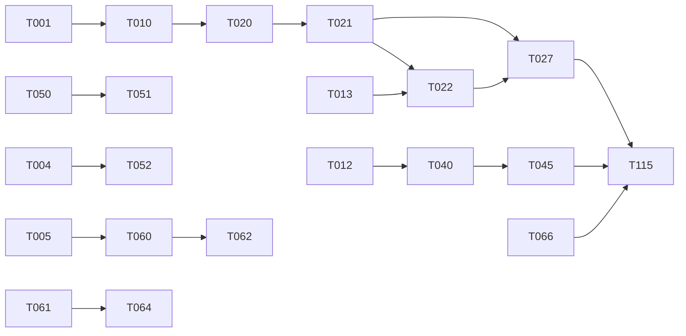

# Tasks: 004 Release Readiness

> "Never half-ass two things. Whole-ass one thing." («Никогда не делай два дела вполсилы. Делай одно дело на всю катушку.») — Рон Свонсон (_Parks and Recreation_)
> "Чё там с сосисками, Чарли? — Пять минут, Турецкий. — Пять минут назад ты сказал, что будет готово через две минуты!" — _Большой куш / Snatch_ (о дейликах и эстимейтах)
> "Первые 90% проекта занимают 90% времени. Оставшиеся 10% — другие 90%." — The 90-90 rule

**Input**: Design documents from `/specs/004-release-readiness/` (spec.md v6, plan.md, research.md + Plan Phase 0 decisions, data-model.md, contracts/)
**Prerequisites**: plan.md (required), spec.md (9 user stories FR-401..443)

**Organization**: Tasks grouped by user story (P1: US1, US2, US3, US4, US9 → then P2: US5, US6, US7, US8). Each story independently testable; MVP = all P1 stories.

## Format: `[ID] [AGENT] [Story?] Description`

- **[AGENT]**: specialist agent (see Agent Tags)
- **[Story]**: US1..US9
- Parallelism derived from Dependency Graph

## Agent Tags

| Tag | Agent | Domain |
| --- | --- | --- |
| `[SETUP]` | orchestrator | shared config, debt cleanup, spikes |
| `[DB]` | database-architect | schema, migrations, backfill |
| `[BE]` | backend-specialist | services, FSM, adapters, APIs + unit tests |
| `[FE]` | frontend-specialist | pages, components, i18n chrome, admin UI |
| `[OPS]` | devops-engineer | DR drill, feature flags, infra |
| `[E2E]` | test-engineer | cross-boundary integration/e2e |
| `[SEC]` | security-auditor | STRIDE verification, supply chain |

## Phase 1: Setup — Green Baseline & Spikes (003 debt is a hard prerequisite: quality gates)

**Purpose**: restore green `validate`/`test`/`build` (003 audit debts), add new deps, run disposed spikes.

- [ ] T001 [SETUP] Repair 003 test debt to green: rewrite `tests/unit/multi-service-cart.test.ts` and `tests/unit/performance-benchmark.test.ts` against the current `computeAvailableSlots` contract (NFR-401 profile: p95 recording, availability load), fix `admin-auth` and `inngest-cas-and-outbox` failures (root-cause, not skip) — `npx tsc --noEmit` and `npx jest` fully green
- [ ] T002 [SETUP] Lint debt: resolve `no-explicit-any`/`no-unused-vars` in `lib/kernel/`, `lib/security/`, `lib/bot/` (003 audit list) so `next build` passes lint; no rule suppressions without inline justification
- [ ] T003 [SETUP] Supply chain: remove unused `better-auth` dep (research D4); add `next-intl`, `@aws-sdk/client-s3`, `@aws-sdk/s3-request-presigner`, `browser-image-compression`; run `scripts/verify-licenses.mjs` + `npm audit` (zero High/Critical unmitigated); registry path entries in `config/oss-reuse-registry.json`
- [ ] T004 [SETUP] Spike S1 (timebox 1d): Telegram themeParams ↔ undesign token mapping on all surfaces; quantitative acceptance per research.md D2; **spike branch, dispose after**
- [ ] T005 [SETUP] Spike S2 (timebox 1d): R2 presign E2E cycle (HEIC→WebP→PUT→URL; p95 presign <50ms; 0 bytes via Node); **spike branch, dispose after**
- [ ] T006 [SETUP] Spike S3 (timebox 1d): i18n key-coverage AST gate PoC (100% resolve in ru/en); **spike branch, dispose after**
- [ ] T007 [SETUP] Spike disposal verification (Constitution XI): `spike/*` branches deleted, zero prototype code in feature branch — checklist note in this file

---

## Phase 2: Foundational (Blocking Prerequisites)

**⚠️ CRITICAL**: No user story work begins until this phase completes (sync barrier).

- [ ] T010 [DB] Expand migration `prisma/migrations/20261025000000_004_release_readiness_expand/` (+`down.sql`): 8 new tables (WaitlistEntry, WaitlistOffer, CustomBookingField, BookingFieldAnswer, NotificationDeliveryLog, SlugRedirect, PaymentAllocationLink, UserPreference), `ALTER TYPE SlotReservationStatus ADD VALUE` (separate statement), nullable columns on Item (`requiresFullPrepayment` default false, `archivedAt`, `sortOrder`) and ShopSettings (`defaultLocale`, `enabledLocales`, `slotGridStepMin` default 30), indexes per data-model.md §3; schema updated in `prisma/schema.prisma`
- [ ] T011 [DB] Idempotent backfill `scripts/backfill-004-language-defaults.ts` (defaultLocale heuristic, rate-limited batches) + migration guard test in `tests/unit/db-gist-and-migration.test.ts` lineage (timeout guards, down.sql drops only new objects)
- [ ] T012 [BE] i18n scaffold: `lib/i18n/` — next-intl request config, message namespaces (web/client-bot/staff-bot/admin/email × ru/en), locale resolution chain (user override > `language_code` > session cookie > instance default, FR-412) + unit tests
- [ ] T013 [BE] `lib/payments/providerContract.ts`: PaymentProvider interface + registry from deployment config; zero-provider mode booking verified (FR-401); unit tests for contract invariants
- [ ] T014 [BE] `lib/notifications/` delivery log (ACCEPTED/FAILED, salted target hash, 90d retention hook) + logger deny-list extension for new surfaces; zero-PII log-scan unit test
- [ ] T015 [BE] `lib/email/` adapter interface + provider adapter (Resend-recommended HTTP API behind interface) + mock contract test (FR-409 fallback readiness)
- [ ] T016 [OPS] Feature flags in `lib/config/integrationProfile.ts` for FSM/payment-provider/waitlist/i18n cutover with killswitch verification test (legacy read paths restorable without DDL)

**Checkpoint**: Foundation ready — green baseline, schema expanded, contracts scaffolded.

---

## Phase 3: US1 — Payments & Booking Integrity (Priority: P1) 🎯 MVP

**Goal**: Provider-neutral payments with server-side invoices; two-track booking FSM with crypto freeze, UNDERPAID, late-payment resolution.
**Independent Test**: Stubbed-gateway lifecycle through one slot (waiting→confirming→finished; partially_paid; expired; late-after-rebook) — contracts/payment-provider.md test matrix.

- [ ] T020 [BE] [US1] `lib/kernel/bookingFsm.ts` — pure two-track transition functions + exhaustive unit tests (auto-confirm IN_CALL unless flag, OUT_CALL PENDING_APPROVAL, HELD TTL 15m, freeze, UNDERPAID, AVAILABLE rollbacks)
- [ ] T021 [BE] [US1] Integrate FSM into `lib/kernel/bookingService.ts`: per-service `requiresFullPrepayment` gating, free-track semantics via existing `requireStaffApprovalForInCall`, snapshots untouched (003 lineage)
- [ ] T022 [BE] [US1] NowPayments adapter behind contract: server-side invoice via provider API; **remove hand-built payment URL** in `app/api/checkout/route.ts` (audit finding); providerPaymentId linkage
- [ ] T023 [BE] [US1] Confirming-freeze: `holdFrozenAt` on first `confirming`; deadlineSweeper/invoiceExpiry respect freeze; unit tests for TTL-vs-freeze race
- [ ] T024 [BE] [US1] UNDERPAID flow: staff alert + customer top-up/cancel message via notification dispatcher; no auto-confirm (tests)
- [ ] T025 [BE] [US1] Stars adapter implements the contract (existing stars tests green — regression only)
- [ ] T026 [BE] [US1] Minor-unit amounts: replace `×100` with CurrencyMetadata scale across payment paths (FR-405/FR-303); multi-currency tests (JPY 0, KWD 3)
- [ ] T027 [E2E] [US1] Stubbed-gateway contract suite: full lifecycle, replay ×100 → one effect, invalid signature 401, late-payment-after-rebook → PAID_REQUIRES_RESOLUTION + refund request + both parties notified (FR-432)

**Checkpoint**: Money path trustworthy; 100-way same-slot race test green (SC-401).

---

## Phase 4: US2 — Calendar & Notification Reliability (Priority: P1) 🎯 MVP

**Goal**: IANA/DST-correct slots with availability reasons; TG→email redundant notifications with delivery log.
**Independent Test**: Non-UTC instance across a DST boundary; forced TG failure → email fallback ≤5 min logged.

- [ ] T030 [BE] [US2] `lib/booking/windows.ts`: compute in `ShopSettings.timeZone` (IANA + DST correct); plumbing of the currently-inert `timeZone` param; DST-boundary unit tests
- [ ] T031 [BE] [US2] Slots API: `unavailableReason` (booked|break) per blocked candidate (FR-408)
- [ ] T032 [BE] [US2] Notification dispatcher: lifecycle events → TG primary → email fallback ≤5 min → delivery log rows; unit tests with mocked failures
- [ ] T033 [FE] [US2] SlotGrid: locale word-month dates (`Intl.DateTimeFormat`), booked/break explanation UI for hidden slots
- [ ] T034 [E2E] [US2] Reliability suite: DST day wall-clock slots; TG-fail→email fallback timing; delivery history visible to staff

---

## Phase 5: US3 — i18n ru/en, All Surfaces (Priority: P1) 🎯 MVP

**Goal**: 100% chrome coverage ru/en on web, both bots, admin, emails; ICU plurals; word-month dates.
**Independent Test**: Switch ru/en across surfaces; `de` fallback; plural checks (US3 scenarios).

- [ ] T040 [FE] [US3] Web chrome i18n: all pages/components keyed; locale switcher storing user override
- [ ] T041 [BE] [US3] Bot strings i18n: client + staff bots via `from.language_code` (grammY middleware over shared dictionaries)
- [ ] T042 [BE] [US3] Admin UI + email template dictionaries (ru/en)
- [ ] T043 [BE] [US3] UserPreference language override API + anonymous-web session cookie fallback (FR-412)
- [ ] T044 [SETUP] [US3] i18n AST coverage gate (S3 findings → production script): 100% of chrome keys resolve in both locales; wired into test suite (NFR-406)
- [ ] T045 [E2E] [US3] i18n acceptance: ru/en journeys, CLDR plurals, unsupported-code fallback, content-stays-authored check (FR-414)

---

## Phase 6: US4 — Hybrid Telegram Experience (Priority: P1) 🎯 MVP

**Goal**: Persistent menu button; bot quick actions; Mini App theme follows Telegram; deep links back into bot.
**Independent Test**: Cold start → confirmed booking ≤3 taps; theme flip light/dark.

- [ ] T050 [BE] [US4] `setChatMenuButton` (web_app) on bot init — persistent storefront entry (FR-415)
- [ ] T051 [BE] [US4] Bot quick actions: my bookings, cancel via token flow, support contact, language switch (FR-416); ≤3-tap journey test
- [ ] T052 [FE] [US4] Mini App themeParams → undesign theme toggle (light/dark) per S1 findings; both themes shipped (FR-417)
- [ ] T053 [FE] [US4] Professionals pages: `tg://` deep links with startapp context (FR-418)
- [ ] T054 [E2E] [US4] Hybrid journey: menu → Mini App → slot → book → cancel via bot; theme flip visual check

---

## Phase 7: US9 — Content Administration UI (Priority: P1) 🎯 MVP

**Goal**: Mobile-first admin (3 tabs, quick-create ≤4 fields, one-tap toggles, presigned R2 uploads); OWNER/OPERATOR split; slug immutability.
**Independent Test**: OWNER on 390px viewport creates service+product+profile+settings in ≤10 min (US9 bar).

- [ ] T060 [BE] [US9] `lib/uploads/presign.ts` + `POST /api/admin/uploads/presign` (R2, TTL ≤5 min, type/size conditions, OWNER/OPERATOR, rate-limited — FR-441)
- [ ] T061 [FE] [US9] Admin scaffold: 3-tab bottom nav; `/admin/catalog` — list with one-tap active toggle, arrow reorder, quick-create sheet (4 required fields + collapsed "more", 15-min duration selector), shared zod validation with API (FR-436/439/440)
- [ ] T062 [FE] [US9] ImageUploader: `browser-image-compression` (WebP ≤1200px ≤200KB) → presign → direct PUT; type/size field-level errors
- [ ] T063 [FE] [US9] `/admin/team`: profiles, portfolio publication, working hours; profile ownership rules
- [ ] T064 [FE] [US9] `/admin/settings`: foundation section (currency, timezone, defaultLocale — OWNER-only server-enforced) + operational settings; currency-confirm gate (FR-438)
- [ ] T065 [BE] [US9] SlugRedirect service: immutable slugs, 301 on API rename, `/professionals/[slug]` redirect-before-404 (FR-437)
- [ ] T066 [E2E] [US9] Content-admin acceptance: RBAC matrix (PERFORMER 403, OPERATOR foundation 403), validation parity, archive-keeps-snapshots, 10-minute setup bar timed run (US9 scenarios)

---

## Phase 8: US5 — Waitlist & Any-Available (Priority: P2)

**Goal**: Deterministic cancellation recovery and cross-master slot packing.
**Independent Test**: Cancel → offer ≤60s → single winner under concurrent claims.

- [ ] T070 [BE] [US5] `lib/waitlist/waitlistService.ts`: join limits, fan-out job (Inngest + sweeper fallback, batch ≤10), offer tokens (SHA-256), claim through the standard booking path (atomic single-winner) — FR-419/420/433
- [ ] T071 [BE] [US5] `lib/waitlist/slotPacker.ts`: any-available greedy (gap penalty < shortest service), slots API `anyAvailable` ordering (FR-421); fragmentation unit tests
- [ ] T072 [FE] [US5] Waitlist UX: join from grid/cancellation, TG offer with inline claim, admin outcome counters (FR-422)
- [ ] T073 [E2E] [US5] Race suite: two claims → CLAIMED/TAKEN; dispatch p95 ≤60s; offer expiry silent

---

## Phase 9: US6 — Custom Booking Fields (Priority: P2)

- [ ] T080 [BE] [US6] Field service: CRUD (archive-only, ≤10 active, 4 types, per-service binding), booking-form inclusion, answer validation (≤1000 chars, numeric bounds), snapshot persistence (FR-423/434)
- [ ] T081 [FE] [US6] Admin field editor + dynamic booking-form render + staff answer view (sanitized)
- [ ] T082 [E2E] [US6] Field acceptance: required block, injection payload sanitized, archive preserves historical answers (US6 scenarios)

---

## Phase 10: US7 — Privacy & Abuse Hardening (Priority: P2)

- [ ] T090 [BE] [US7] Zod-refine OUT_CALL address at booking boundary (FR-425) + mixed-cart block with split guidance in checkout UI/API (FR-426)
- [ ] T091 [BE] [US7] Rate limits: booking create/cancel, waitlist join/claim, presign, bot commands (FR-427); bounded payload caps
- [ ] T092 [BE] [US7] PII closure: `AuditEvent.reason` redaction pre-persist; `serviceAddressSnapshot` + BookingFieldAnswer + delivery-log retention in nightlyPurge (FR-428); automated log-scan (SC-403)
- [ ] T093 [BE] [US7] Staff bot: confirm barrier on destructive actions (`showAlert`), configurable rejection notification policy (FR-429)
- [ ] T094 [OPS] [US7] DR drill with REAL restore: `scripts/dr-restore-drill.ps1` (pg_restore into scratch DB, verify settings/items/staff/bookings/waitlist, measured RTO/RPO, PASS only on evidence); retire the stub (audit T059)
- [ ] T095 [SEC] [US7] STRIDE verification pass per plan.md matrix: webhook HMAC regression, presign abuse cases, RBAC split probes, rate-limit bypass attempts — findings fixed or documented

---

## Phase 11: US8 — Design System Completion (Priority: P2)

- [ ] T100 [FE] [US8] Gray neutrals → `base-*` surface tokens across all surfaces (inventory → replace → both-theme visual pass)
- [ ] T101 [FE] [US8] Light theme `undrlla` first-class: semantic contrast pairs verified both themes (US8-SC3); forced-dark remnants removed
- [ ] T102 [SETUP] [US8] grep gate: zero generic-palette/raw-hex in brand/semantic roles (FR-431) — CI-able script

---

## Phase 12: Polish & Cross-Cutting

- [ ] T110 [OPS] Update `docs/whitelabel-quickstart.md` + runbook: FSM, waitlist, content-admin, i18n setup, media/R2, email
- [ ] T111 [E2E] Run `quickstart.md` tracer bullet end-to-end on a fresh instance; record timings against NFR-401/402
- [ ] T112 [OPS] Rollback rehearsal on scratch environment: feature-flag killswitch + down-migration chain (per plan.md §Rollback)
- [ ] T113 [SEC] Final supply chain + SBOM/license verification; `npm audit` clean; zero-PII telemetry audit on staging
- [ ] T114 [OPS] Component disposal: legacy hand-built payment-URL branch, `×100` arithmetic remnants, dead spike fixtures (ISO 12207 Disposal)
- [ ] T115 [E2E] Full journey regression: all 9 stories' Independent Tests green on one instance
- [ ] T116 [SETUP] Quickstart + DR drill evidence attached to feature dir; `/speckit.analyze` preparation

---

## Dependency Graph

### Legend

- `→` = unlocks; `+` = all-of join; unlisted tasks start freely within their phase.

### Dependencies

```
T001 → T010 (green baseline before schema work)
T002 → T016
T003 → T012, T015
T004 → T052
T005 → T060
T006 → T044
T010 → T011, T020, T070, T080, T090
T011 → T111
T012 → T040, T041, T042
T013 → T022, T025, T027
T014 → T032, T024
T015 → T032
T016 → T021
T020 → T021
T021 → T022, T023, T027
T022 → T027
T023 → T027
T026 → T027
T030 → T031, T071
T032 → T034, T072
T040 → T045
T041 → T045
T042 → T045
T043 → T045
T050 → T051
T051 → T054
T052 → T054
T053 → T054
T060 → T062
T061 → T063, T064
T061 + T062 + T063 + T064 + T065 → T066
T070 → T072, T073
T071 → T073
T080 → T081
T081 → T082
T090 → T095
T092 → T113
T094 → T111
T100 → T101
T101 → T102
T066 + T045 + T054 + T034 + T027 → T115 (all MVP stories done)
T115 → T116
T007 → T116 (disposal verified before closeout)
```

### Self-Validation Checklist

- [x] Every task ID referenced exists above
- [x] No circular dependencies
- [x] No orphan IDs
- [x] Fan-in `+` only, fan-out `,` only
- [x] No chained arrows on a single line

---

## Dependency Visualization (MVP excerpt)



---

## Parallel Lanes

| Lane | Agent Flow | Tasks | Blocked By |
| ---- | ---------- | ----- | ---------- |
| 1 | [SETUP] baseline+spikes | T001, T002, T003 → T004, T005, T006, T007 | — |
| 2 | [DB] schema | T010 → T011 | T001 |
| 3 | [BE] payments/FSM | T013 → T020 → T021 → T022/T023 → T027 | T010, T016 |
| 4 | [BE] reliability | T014 + T015 → T032 → T034; T030 → T031 | T010, T003 |
| 5 | [FE/BE] i18n | T012 → T040/T041/T042 → T043 → T044, T045 | T003 |
| 6 | [BE/FE] hybrid TG | T050 → T051; T004 → T052; T053 → T054 | T004 |
| 7 | [BE/FE] content admin | T005 → T060 → T062; T061 → T063, T064; T065 → T066 | T005, T012 |
| 8 | [BE/FE] waitlist | T070 → T072, T073; T071 → T073 | T010, T021, T032 |
| 9 | [BE/FE] custom fields | T080 → T081 → T082 | T010 |
| 10 | [BE/OPS/SEC] hardening | T090–T095 | T070, T080 |
| 11 | [FE] design completion | T100 → T101 → T102 | — |
| 12 | [E2E/OPS] polish | T110–T116 | all stories |

---

## Agent Summary

| Agent | Task Count | Can Start After |
| ----- | ---------- | --------------- |
| [SETUP] | 11 (T001–T007, T044, T102, T116) | immediately |
| [DB] | 2 (T010, T011) | T001 |
| [BE] | 22 (T012–T015, T020–T026, T030–T032, T041–T043, T050, T051, T060, T065, T070, T071, T080, T090–T093) | T010/T013 per lane |
| [FE] | 13 (T033, T040, T052–T054, T061–T064, T072, T081, T100, T101) | lane deps |
| [OPS] | 4 (T016, T094, T110, T112) | T002 / story deps |
| [E2E] | 10 (T027, T034, T045, T054, T066, T073, T082, T111, T115) | story impl |
| [SEC] | 2 (T095, T113) | hardening + near-close |

**Critical Path**: T001 → T010 → T020 → T021 → T027 → T115 → T116 (payments/FSM spine).

**Total**: 60 tasks.

---

## Agent Dispatch Plan

| Agent | Subagent/Command | Skills | Input Context | Tasks | Files |
| ----- | ---------------- | ------ | ------------- | ----- | ----- |
| `[SETUP]` | orchestrator | architecture, system-design-patterns, clean-code | plan.md §Technical Context, research.md Plan Phase 0 | T001–T007, T044, T102, T116 | `package.json`, `tests/unit/`, `config/oss-reuse-registry.json` |
| `[DB]` | database-architect | database-design, prisma-expert, clean-code | data-model.md (full), plan.md §Migration | T010, T011 | `prisma/schema.prisma`, `prisma/migrations/`, `scripts/` |
| `[BE]` | backend-specialist | api-patterns, nodejs-best-practices, typescript-expert, clean-code | contracts/ (all 4), data-model.md §1–2, plan.md §STRIDE | T012–T015, T020–T026, T030–T032, T041–T043, T050–T051, T060, T065, T070–T071, T080, T090–T093 | `lib/`, `app/api/` |
| `[FE]` | frontend-specialist | react-patterns, nextjs-best-practices, tailwind-patterns, frontend-design | contracts/i18n-notifications.md, contracts/admin-content-uploads.md, content-admin-research.md §4 | T033, T040, T052–T054, T061–T064, T072, T081, T100–T101 | `app/`, `components/` |
| `[OPS]` | devops-engineer | docker-expert, server-management, deployment-procedures | plan.md §ORR/DR, quickstart.md | T016, T094, T110, T112 | `scripts/`, `docker/`, `docs/` |
| `[E2E]` | test-engineer | testing-patterns, webapp-testing, tdd-workflow | quickstart.md, contracts/ test matrices | T027, T034, T045, T054, T066, T073, T082, T111, T115 | `tests/` |
| `[SEC]` | security-auditor | vulnerability-scanner, code-review-checklist | plan.md §STRIDE, spec.md §Security | T095, T113 | project-wide |

---

## Implementation Strategy

### MVP First (P1 stories: US1 + US2 + US3 + US4 + US9)

1. Phase 1 (green baseline — non-negotiable: quality gates are red from 003 debt)
2. Phase 2 (foundational sync barrier)
3. Phases 3–7 in lanes (payments/FSM is the critical path; i18n and content-admin parallelize)
4. STOP and VALIDATE: run each P1 story's Independent Test; quickstart tracer bullet
5. Demo the flagship flow: lander (underundre.com) → shop.underundre.com → book → pay (stub) → waitlist

### Incremental Delivery

P1 (MVP) → US5 waitlist (money) → US6 custom fields (differentiator) → US7 hardening (GDPR baseline for launch) → US8 design completion → Polish. Launch gate: P1 + US7 minimum (integrity + GDPR); US5/US6 may ride the first post-launch week if squeezed.

### Parallel Agent Strategy

Orchestrator owns Phase 1; after the sync barrier, dispatch lanes 2–7 in parallel (DB → BE lanes 3/4/5 → FE when contracts ready); lanes 8–9 after US1 lands; SEC last. One PR = one concern; commit per task group.

---

## Notes

- Tests are included per story (E2E tasks) because spec NFRs demand measurable acceptance (SC-401..406) — not decorative.
- T001/T002 are debts from `003-tasks-audit.md` — they block ALL quality gates (constitution: validate/test/build green before done).
- Business plan v18.4 constraints are embedded: ≤500 MB RSS (no inference runtimes anywhere), white-label isolation, Sprint B lineage.
